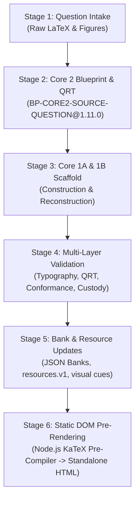

# IMO & Olympiad Curriculum Engineering Pipeline
## End-to-End Runbook: Question Intake → Core 2 → Core 1A/1B → Validation → Update → Static DOM HTML

This skill defines the canonical lifecycle, schemas, validation gates, and compilation procedures for transforming raw competitive mathematics questions (e.g. SOF IMO Grade 9) into fully audited, cognitive-tier Core 2 question banks, pedagogical Core 1A/1B units, and zero-JS static DOM pre-rendered tablet applications.

---

## 1. Architectural Pipeline Lifecycle



---

## 2. Stage 1: Question Intake & Taxonomy Ingestion

### Goals
- Ingest raw Olympiad competition problems (SOF IMO sets, topic master banks, sample papers).
- Standardize metadata, naming conventions, and taxonomic classification.

### Intake Rules
1. **Canonical Question ID**: Format as `SOF-IMO-G{grade}-{topic}-Q{nnn}` or `SOF-IMO-G{grade}-L1-{year}-{set}-Q{nnn}` (e.g. `SOF-IMO-G09-CIRCLES-Q001`).
2. **File Naming Mandate**: When topic-specific patterns are specified (e.g. `*IMOCircle*`), all unit, bank, and test files must strictly conform (e.g., `core1a-IMOCircle-grade9.v1.json`, `test_IMOCircle_custody.py`).
3. **Taxonomy Structure**:
   - `section`: `"mathematical_reasoning"`, `"everyday_mathematics"`, or `"achievers_section"`.
   - `taxonomy.topic`: Primary curriculum topic (e.g., `"circles"`).
   - `taxonomy.topic_label`: Formatted topic label (e.g., `"Circles and Cyclic Quadrilaterals"`).
   - `taxonomy.subtopic`: Specific theorem/concept domain (e.g., `"Ptolemy's Theorem & Chord Products"`).

---

## 3. Stage 2: Core 2 Blueprint & 28-Cell QRT Cognitive Formulation

All Core 2 questions must strictly implement `BP-CORE2-SOURCE-QUESTION@1.11.0`.

### A. 4-Tier Cognitive Difficulty Distribution
Every question bank must maintain a rigorous cognitive distribution:
- **D1 · Foundational Recall & Direct Construction**: Direct theorem applications, standard definitions, single-step geometric calculations.
- **D2 · Standard Olympiad**: Multi-step deductive chains, angle-chasing, basic auxiliary constructions.
- **D3 · Hard Olympiad**: Advanced synthesis, concyclicity proofs, power-of-a-point invariants, multi-stage configurations.
- **D4 · Achievers HOTS**: Extremal boundary cases, invariant transformations (circular inversion, cross-ratio), sharpness characterizations.

### B. 5-Component Difficulty Breakdown
`difficulty_score` (1–10) must equal the exact sum of its 5 constituent components:
1. `concept_model_selection`: (1–3) Complexity in identifying the governing geometric invariant.
2. `representation_translation`: (1–2) Translation between diagram, algebraic formulation, and geometric symbol.
3. `reasoning_chain_length`: (1–3) Number of discrete deductive proof steps required.
4. `algebra_computational_load`: (1–2) Algebraic manipulation complexity.
5. `trap_exception_sensitivity`: (1–2) Susceptibility to subtle boundary exceptions or common fallacies.

### C. Canonical QRT Demands
> [!IMPORTANT]
> The demand `CALCULATE` is strictly deprecated. Every question must use one of the canonical demands: `MODEL`, `JUSTIFY`, `SYNTHESIZE`, `GENERALIZE`, `CLASSIFY`, `VERIFY`.

### D. 28-Cell QRT Cognitive Contract
Every question must declare a complete `qrt_contract` object:
- **`X`**: Specific configuration, givens, and diagram properties.
- **`Y`**: Governing invariant, geometric theorem, or algebraic relation.
- **`Z`**: Crucial deductive link connecting the invariant to the specific geometry.
- **`W`**: Deductive proof closure, answer determination, and boundary condition.
- **`wrong_idea`**: Tempting misconception, false theorem extension, or procedural shortcut.
- **`replacement_rule`**: Rigorous mental refutation and corrective mathematical invariant.

### E. Diagnostic Distractors & Tempting Traps
- Exactly 4 disjoint options (`A`, `B`, `C`, `D`) with zero duplicates.
- `distractor_rationale`: Must contain keys for all options `A`, `B`, `C`, `D` (explaining why distractors fail and why the key is correct) plus `trap` (detailing the exact cognitive pitfall).

### F. Progressive Staggered Hint Ladder Protocol
> [!IMPORTANT]
> **Staggered Progression Mandate**: Hints must NEVER be revealed all at once upon expanding the disclosure. The user interface must enforce a progressive, visually staggered unlock flow:
> 1. **Tier 1 (Conceptual Nudge)**: Visible immediately when the Hint Ladder `<details>` element is opened. Broad structural question directing attention to the governing invariant.
> 2. **Tier 2 (Tactical Step)**: Locked initially behind an unlock button (`🔓 Need more guidance? Unlock Tier 2 · Tactical Step`). Hidden until the student explicitly requests deeper assistance. Concrete auxiliary construction or intermediate algebraic relation.
> 3. **Tier 3 (Crux Move)**: Locked initially behind an unlock button (`🔓 Still stuck? Unlock Tier 3 · Crux Move`). Accessible only after Tier 2 has been unlocked. The definitive mathematical pivot that unlocks the solution.
> 4. **Progress Tracker**: Visual indicators (steps 1–2–3 with connecting track fills) conveying the active assistance level.

### G. Source Provenance Display Mandate
Every question card in the standalone tablet application must display a prominent **Source Provenance Tag** at the top of the card:
- Paper Code: e.g., `SOF-IMO-G09-CIRCLES-MASTER`
- Year & Question Number: e.g., `2025-26 · Q1`
- Exam Section Badge: e.g., `MATHEMATICAL REASONING`, `ACHIEVERS SECTION`
- Semantic markup: `<div class="card-source-tag"><span class="source-icon">📜</span>...</div>`.

### H. Model Solution & Independent Dual-Check
- `solution.derivation`: Numbered, KaTeX-formatted step-by-step mathematical proof.
- `solution.independent_check`: Alternative verification route (e.g. Cartesian coordinate check, trigonometric form, complex cross-ratio, or boundary limit).

### I. Authentic Vector Figures
- SVG diagrams referenced in `figure_ref`.
- Strict **$\ge 14\text{px}$ font-floor** on all `<text>` and `<tspan>` elements.
- Accessible ARIA labels and semantic element tagging.

---

## 4. Stage 3: Core 1A Construction & Core 1B Reconstruction

### Core 1A: Declarative Concept Construction (`BP-CORE1A-CONSTRUCTION`)
- Schema: `grade9v3-core1a-construction/v1`.
- Declares package ID (e.g. `CORE1A-MATH-{TOPIC}-GRADE9`).
- `linked_core2_refs`: Array linking every Core 2 question ID in the bank.
- `entry_assumptions`: Prerequisite geometric axioms and definitions.
- `inferential_jump`: Detailed exposition of the cognitive leap required.
- `relation_refs`: Explicit definitions of `domain`, `hypotheses`, and `excluded_values`.
- `representation`: Array mapping multimodal representations:
  - `symbol`: Formal mathematical notation (e.g., `OM perp AB implies AM = MB = AB / 2`).
  - `svg_element_ref`: Target SVG asset name.
  - `word_meaning`: Pedagogical explanation of the invariant.
- **`structural_concept_ontology`**: Comprehensive 5-pillar mathematical ontology:
  - Each pillar contains `name`, `foundational_theorems`, `governing_equation`, and `algebraic_nature`.
  - Maps fundamental geometric invariants (e.g., Euclidean Chord Metric, Subtended Arc Concyclicity, Projective Chord Products, Cyclic Quad Bilinear Forms, Triangle Center Separation).
- **`concept_dependency_graph`**: 4-layer epistemic network:
  - `axiom_layer`: Foundational Euclidean axioms and metric postulates.
  - `lemma_layer`: Intermediate geometric lemmas (chord bisection, inscribed angles, Thales).
  - `core_invariant_layer`: Cyclic quad supplementarity, power of a point, Mamikon sweeping.
  - `olympiad_synthesis_layer`: Ptolemy's theorem, circular inversion, incenter-excenter concyclicity, Euler distance inequality.
- **`cognitive_conflict_matrix`**: Misconception refutation matrix:
  - Array of $\ge 5$ items with `naive_misconception`, `mathematical_refutation`, and `governing_invariant`.

### Core 1B: Pedagogical Reconstruction Cycle (`BP-CORE1B-RECONSTRUCTION`)
- Schema: `grade9v3-core1b-reconstruction/v1`.
- Declares `answer_before_attempt: FORBIDDEN`.
- Implements 4-Stage Cognitive Commitment Loop:
  1. `stage_1_predict`: Multiple-choice prediction forcing qualitative commitment before calculation.
  2. `stage_2_attempt`: Locked working area requiring user input before revealing model closure.
  3. `stage_3_reconstruct`: Invariant cross-examination dialog steps and common fallacy refutations across multiple dialog steps.
  4. `stage_4_boundary_test`: Perturbation and extremal limiting test (e.g., $d \to 0$ in Euler's formula).
- **`structural_reconstruction_scenarios`**:
  - Array of $\ge 4$ deep multi-scenario cycles, each with `scenario_id`, `focus`, `core_question`, `mathematical_core`, and `cognitive_takeaway`.
  - Exemplifies invariant preservation under projective and continuous deformations.
- **`cognitive_dissonance_resolution_framework`**:
  - Pairs intuitive perceptual traps with formal geometric resolutions (e.g., radical axis equal-power lines, circumcircle angle constancy).

---

## 5. Stage 4: Multi-Layer Validation Suite

Every bank must pass all 5 validation layers with **zero findings**:

### Layer 1: KaTeX Math & Typography Audit
Command: `python Shared/tools/audit_math_and_fonts.py`
- Checks zero KaTeX parse errors.
- Checks delimiter parity (no unmatched `$`).
- Checks no HTML entities in math (`&lt;`, `&gt;`).
- Checks all `%` inside math are escaped as `\%`.
- Checks minimum CSS font-floor $\ge 14\text{px}$ (0.88rem).
- **`ASSET_UNRESOLVED` enforcement**: Verifies all `<link>` and `<script>` paths resolve to real files on disk.

### Layer 2: 28-Cell QRT Cognitive Matrix Audit
Command: `python Shared/tools/audit_core_against_qrt.py`
- Audits hosted HTML and question banks against the 28-cell QRT matrix.
- Requires 100% compliance across D1, D2, D3, D4 with 0 flagged.

### Layer 3: Shell Standalone Conformance
Command: `python Shared/tools/standalone_conformance.py <HTML_PATH>`
- `LINKS_RESOLVE`: Zero missing local references or broken relative paths.
- `MATH_UNRENDERED`: Zero raw unrendered TeX in visible text without renderer.
- `STORAGE_GUARDED`: All `localStorage` / `sessionStorage` wrapped in `try/catch`.
- `REMOTE_RUNTIME`: Zero unauthorized remote CDNs or external scripts.

### Layer 4: Multimodal Visual Cue Audit
Command: `python Shared/tools/audit_missing_svgs.py --export-cues`
- Scans question bank for visual requirements.
- Validates SVG existence and schema integrity.
- Exports synchronized manifest to `Mathematics/research/visual_cues_manifest.json`.

### Layer 5: Dedicated Custody Test Suite
Command: `python -m unittest tests/test_{Topic}_custody.py -v`
- Asserts total question count.
- Asserts 4-tier difficulty distribution.
- Asserts option disjointness and answer key integrity.
- Asserts distractor rationales and trap diagnostics for every question.
- Asserts 3-tier hint ladders.
- Asserts SVG validity and font-floor.
- Asserts Core 1A and Core 1B package schemas.
- Asserts resource registration in `resources.v1.json`.
- Asserts standalone tablet app zero audit findings.

---

## 6. Stage 5: Bank & Resource Updates

1. **Question Bank**: Write formatted JSON to `Mathematics/question-bank/sof-imo-{topic}-grade9.core2.json`.
2. **Resource Registry**: Register in `Mathematics/question-bank/resources.v1.json`:
   ```json
   {
     "id": "RES-MATH-CORE2-{TOPIC}-MASTER",
     "title": "SOF IMO Grade 9 {Topic} Dedicated Question Bank",
     "path": "Mathematics/question-bank/sof-imo-{topic}-grade9.core2.json",
     "total_questions": 50,
     "blueprint_ref": "BP-CORE2-SOURCE-QUESTION@1.11.0"
   }
   ```
3. **Master Suite Bridge**: Add navigation tab linking to the standalone app in:
   - `standalone/mathematics-imo-grade9-master-suite.html`
   - `public/standalone/mathematics-imo-grade9-master-suite.html`

---

## 7. Stage 6: Standalone Tablet App & Static DOM Pre-Rendering

> [!CAUTION]
> **Client-Side KaTeX Failure Mode**: Never rely solely on client-side JavaScript (`renderMathInElement`) to render math in standalone HTML apps. In webviews, Electron, and iframe embeds (such as chat UI artifacts), Content Security Policies (CSP) and iframe sandboxes often block script execution from `data:` URIs or external CDNs, leaving mathematical formulas displaying as broken raw TeX (`$13\text{ cm}$`).

### The Solution: Static DOM Pre-Rendering
All standalone tablet applications must be pre-compiled at build time via Node.js KaTeX:

1. **Pre-Render All Math at Build Time**:
   Run a batch pre-renderer (e.g., `scratch/prerender_engine.py`) over the HTML output. Replace every `$..$`, `$$..$$`, `\[..\]`, and `\(..\)` in stems, options, hints, and derivations with static `<span class="katex"><span class="katex-html">...</span></span>` markup.
2. **Embed Offline KaTeX Base64 Typography**:
   Embed self-contained KaTeX CSS containing inlined WOFF2 font data URIs:
   `<link id="offline-katex-css" rel="stylesheet" href="data:text/css;base64,...">`
3. **Zero JavaScript Dependency**:
   Because the math is already pre-compiled into DOM spans, the user's browser renders it immediately upon parsing the HTML, with **zero script execution required**.
4. **WCAG Compliance**:
   - Touch targets $\ge 48\text{px}$ (WCAG 2.5.5).
   - Text font floor $\ge 14\text{px}$ (0.88rem).
   - Interactive options with instant feedback, distractor diagnostics, and tempting trap alerts.

---

## 8. Quick Execution Commands

```bash
# 1. Regenerate question banks and standalone apps with static DOM pre-rendering
python scratch/build_{topic}_master_app.py

# 2. Run standalone conformance audit (fail-closed)
python Shared/tools/standalone_conformance.py standalone/practice/core2-mathematics-{topic}-grade9-master.html

# 3. Run typography, math syntax, and font-floor audit
python Shared/tools/audit_math_and_fonts.py

# 4. Synchronize visual cues manifest
python Shared/tools/audit_missing_svgs.py --export-cues

# 5. Run topic custody test suite
python -m unittest tests/test_{Topic}_custody.py -v

# 6. Run full IMO regression test suite
python -m unittest discover -s tests -p "test_imo_*.py" -v
```
