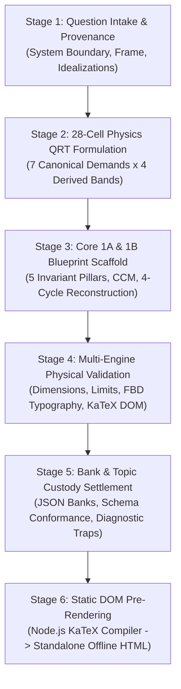

# Olympiad & Foundation Physics Curriculum Engineering Pipeline
## End-to-End Runbook: Question Intake → 28-Cell QRT → Core 1A/1B → Multi-Engine Physical Validation → Static DOM HTML

This skill defines the canonical lifecycle, schemas, validation gates, and compilation procedures for transforming raw competitive physics questions (e.g. NSEP, IPhO, JEE Foundation) into fully audited, cognitive-tier Core 2 question banks, pedagogical Core 1A/1B units, and zero-JS static DOM pre-rendered tablet applications.

> [!CAUTION]
> **Strict Concurrency & Remote Policy**:
> All assets, branches, commits, test suites, and tablet artifacts are developed, verified, and preserved strictly in local workspace custody under the **NEVER MERGE TO REMOTE** protocol. No remote git push, remote pull request merge, or remote issue comment posting is permitted.

---

## 1. Architectural Pipeline Lifecycle



---

## 2. Stage 1: Question Intake & System Parameter Protocol

### Intake Invariants
Every physics question must be captured through a closed-system physical definition before algebraic manipulation:
1. **Source Provenance**: Authentic examination metadata badges (`paper_code`, `year`, `question_number`, `tier`).
2. **System Parameters**:
   - `system_boundary`: Explicitly demarcates which physical bodies belong to the system and which constitute the external environment.
   - `reference_frame`: Declares whether the analysis is conducted in an inertial laboratory frame or an accelerated/rotating non-inertial frame (with explicit D'Alembert pseudo-forces).
   - `idealizations`: Explicitly registers assumptions (e.g., massless inextensible strings, frictionless pulleys, Coulomb dry friction, uniform gravity).

---

## 3. Stage 2: 28-Cell Physics QRT Cognitive Formulation

### A. The 7 Canonical Physical Demands
Cognitive demands are classified strictly by the **decisive physical cognitive act**:
- **`RETRIEVE`**: Direct recall and recognition of physical laws, SI dimensional units, and scalar/vector status.
- **`EXPLAIN`**: Causal phenomenological explanations connecting interactions to observed dynamics without full algebraic computation.
- **`APPLY`**: Routine execution of Newton's laws, kinematics, or impulse-momentum on a single isolated system with explicit parameters.
- **`MODEL`**: System boundary isolation, reference frame choice, and threshold condition checks (e.g., static vs. kinetic friction transition).
- **`REPRESENT`**: Scientific translation across representations: Free-Body Diagrams (FBD), coordinate decomposition, or trajectory graphs.
- **`SYNTHESIZE`**: Multi-regime coupling bridging distinct domains (e.g., Kinematics $\leftrightarrow$ Dynamics $\leftrightarrow$ Energy Conservation $\leftrightarrow$ Geometric String Constraints).
- **`JUSTIFY`**: Deductive mathematical and physical proofs of conservation laws, boundary invariants, or asymptotic bounds.

### B. The 5-Factor Physical Complexity Index ($f_1$–$f_5$)
Difficulty bands ($D_1$ to $D_4$) are derived from 5 objective complexity factors ($f_i \in [1, 4]$):
1. $f_1$ (**System Boundary & Body Coupling**): $1 = \text{single point mass}$; $2 = \text{single rigid body}$; $3 = \text{two coupled bodies}$; $4 = \text{multi-body constrained system}$.
2. $f_2$ (**Vector & Coordinate Dimensionality**): $1 = \text{1D scalar}$; $2 = \text{1D vector with signs}$; $3 = \text{2D Cartesian decomposition}$; $4 = \text{intrinsic curvilinear components } (a_t, a_n)$.
3. $f_3$ (**Constraint Latency**): $1 = \text{explicit parameters}$; $2 = \text{single taut string}$; $3 = \text{movable pulley/wedge constraint}$; $4 = \text{self-adjusting threshold } (f_s \le \mu_s N)$.
4. $f_4$ (**Domain Coupling**): $1 = \text{single formula}$; $2 = \text{2-stage kinematics}$; $3 = \text{Force + Energy coupling}$; $4 = \text{multi-regime synthesis}$.
5. $f_5$ (**Mathematical Friction**): $1 = \text{arithmetic evaluation}$; $2 = \text{linear equation}$; $3 = \text{simultaneous linear system}$; $4 = \text{parametric symbolic optimization}$.

$$\text{Derived Score } S = \frac{f_1 + f_2 + f_3 + f_4 + f_5}{5}$$
- **$D_1$ (Foundational)**: $1.0 \le S \le 1.6$
- **$D_2$ (Standard Olympiad)**: $1.8 \le S \le 2.6$
- **$D_3$ (Hard Olympiad)**: $2.8 \le S \le 3.4$
- **$D_4$ (Achievers HOTS)**: $3.6 \le S \le 4.0$

### C. Protected Learner Work ($W$) & Rival Demands
- **Protected Work $W$**: The decisive physical insight (e.g., verifying slip threshold before applying $\Sigma F = ma$) that must NEVER be revealed in pre-attempt support.
- **Rival Demand Rejection**: Every record must document at least one rejected rival cell and provide a falsifying pedagogical rationale.

---


### D. NLM-FIX1 demand-calibrated generation (Owner pilot, 2026-10-18)

**Authority order:** Owner's competency/demand intent > scientifically defensible physics > source digest > authored example wording. The PDFs are *not* in source custody: their unseen wording, figures and exact difficulty are **UNKNOWN**, not grounds for declaring the benchmark wrong. Core2 scenarios are calibration examples, not stories to copy.

For each NLM item, perform these **separate** operations before asserting a tile:
1. Choose the benchmark's **decisive physics action** (not its nouns). State the misconception/falsifier and link a Core1 NLM competency to a provisional Core2 demand anchor. Design a genuinely different situation; do not merely rename the characters, numbers, or props.
2. Identify the correct body/system and physical idealizations; independently solve the new situation and check physical signs, units and edge cases. If a proposed D4 regime exceeds plausible Grade 9 scaffolding, lower the band without fabricating complexity.
3. **Measure**, never back-fill, the integer vector (system_coupling, vector_dimensionality, constraint_latency, domain_coupling, math_friction), in this precise order. Copy neither a profile's illustrative factor vector nor a sibling item's. Use the scales in §3B. Each question MUST put a concrete one-line justification for each score in `qrt_contract.factor_evidence` keyed by those five fields. State **which actual feature** earns the score and why a higher factor is *not* earned. Profiles are examples, not scoring authority.
4. Compute `S=(f1+f2+f3+f4+f5)/5` from the recorded scores. Demand and derived band alone determine `cell_id`. D1: S<=1.6; D2: 1.8–2.6; D3: 2.8–3.4; D4: >=3.6. A disagreement is a FAIL, even if a desired cell is empty. Any legacy back-filled vectors [4,3,4,4,4], [3,2,3,3,3], [2,1,2,2,2] are rejected in NLM. A vector reused in a band by more than three items requires a specific `vector_reuse_justification` on every item, and still needs independent factor evidence.
5. Build and scientifically review the **H1/H2/H3 prompt-reveal** ladder, with `guidance_role` values `decisive_physics`, `representation`, `first_equation_only`. H1 points to the key event, state, body, boundary, axis or invariant; H2 asks for a chosen-body FBD, action/reaction ownership, signed momentum state, v-t/p-t graph, or system representation; H3 writes only the **first** governing equation or inequality, never a solved final result. Reveal the working and answer **only** in the model proof.
6. Demand-test the result without the benchmark's story in view: a learner must make the same physical decision at a defensible depth. Review false alternatives, hint leakage, multiple physical regimes, and genuine novelty. `REPRESENT` is a first-class demand at every justified depth: require the actual FBD/axis/graph/interaction translation, rather than a hidden calculation with a REPRESENT tag.

**Scope of automatic checks:** NLM score arithmetic, presence of five evidence fields, forbidden vectors, hint-role structure, REPRESENT non-emptiness and missing tile reporting are machine-enforced. Truth of the factor justifications, scenario novelty and equivalence to the unseen PDFs require independent human/Antigravity judgment; a green checker is not that judgment.

**Permission exception:** the Owner-authorized, unmerged NLM-FIX1 / NLM-FIX2 stacked PR may be pushed for OTM review despite the general local-only policy above. No app or unrelated-topic regeneration, axis edits or merge is authorized.

### E. NLM-FIX2 depth, evidence independence and cell honesty (2026-10-19)

**Precedence:** scientific validity and the specified cognitive demand take priority over populating all 28 cells. An empty NLM cell can count as *accounted for* only when `mechanics-nlm.not_applicable_cells` has a concrete physics explanation. This does **not** claim that the question is present or that an independent validator marked the tile FINE. Never silently change the shared QRT axes or declare the benchmark wrong.

1. **Score margin:** every NLM D4 item's measured mean must be **S >= 3.8**, not merely >=3.6. If its actual physics is only D3, retag its band and cell honestly. Independently justify all five factor scores; a made-up extra body, diagram axis, or unsupported regime does not earn a point. Intrinsic radial and tangential acceleration genuinely merits f2=4, whereas routine straight-line and incline axes do not. A unilateral contact bound (`N >= 0`) can be f3=4 when it actually decides a transition; a decorative inequality cannot.
2. **Evidence uniqueness:** use item-specific reasons that describe the body, axes, constraints, coupled physical laws and actual symbolic work. The validator checks the displayed score in each rationale, tests complete-factor evidence similarity and rejects near-identical rationales across any two questions. Merely replacing a prop or number in five recycled lines is invalid, even if the factor vector happens to differ.
3. **D4 discriminator variety:** assign `qrt_contract.d4_discriminator_type` using an ID declared by the NLM adapter. At least three different types must be present. The validator reports counts and warns if one type dominates over 60 percent. Required examples are coupled curved/2D dynamics, impulse followed by kinematics and a system-boundary change that changes the external-force law.
4. **Generation method:** select demand first, then construct an independent new physical event. For 10 or more Core2-mapped corrections, change the *route to the decision*, not just prose, setting, characters, quantities or drawing style. Verify each new option, reasoning step, sign and limiting check against the revised situation. A new `provenance.scenario_distance` annotation is a trace for independent review, not evidence that novelty has been proved.
5. **Human gate:** a validator pass certifies schema, reported evidence and scoring consistency, but cannot prove that any newly written score is pedagogically honest or that scenario distance equals the unseen benchmark's demand. Independent Antigravity P4 must judge source-independent novelty, Grade-9 suitability and scientific correctness. Mark the exact benchmark PDF wording **UNKNOWN** without local PDF custody.

**Pilot mapping:** `EXPLAIN-D4`, `RETRIEVE-D3`, `RETRIEVE-D4` and `SYNTHESIZE-D1` are presently marked *not applicable* in mechanics-nlm, because their demand definitions conflict with the cognitive-factor depth; these are explicit, reviewable exceptions, not synthetic filler items. A future genuine task can replace an exception after a factor-based demonstration.

**Authorized PR exception:** Owner and OTM authorize a bounded, unmerged NLM-FIX2 stacked PR to the current Physics candidate branch. The local-only statement above remains a default for other work.

---

## 4. Stage 3: Core 1A & Core 1B Physical Architectures

### Core 1A: Conceptual Construction
1. **5 Invariant Physical Pillars**:
   - *P1 (Inertial Frames & Galilean Invariance)*: $\Sigma \vec{F} = \vec{0} \iff \vec{v} = \text{const}$.
   - *P2 (System Isolation & Internal Cancellation)*: $\Sigma \vec{F}_{\text{ext}} = M_{\text{tot}} \vec{a}_{\text{cm}}$.
   - *P3 (Orthogonal Vector Decomposition)*: $\Sigma F_x = m a_x, \; \Sigma F_y = m a_y$.
   - *P4 (Kinematic String/Pulley Invariants)*: $\sum \vec{T}_i \cdot \vec{a}_i = 0$.
   - *P5 (Non-Holonomic Friction Thresholds)*: $f_s \le \mu_s N \implies$ static vs. kinetic branch.
2. **4-Layer Dynamic Dependency Graph**:
   $$\text{Primitive Definitions } \longrightarrow \text{Axiomatic Laws } \longrightarrow \text{Derived Invariants } \longrightarrow \text{Coupled Synthesis}$$
3. **Cognitive Conflict Matrix (CCM)**:
   Juxtaposing Aristotelian/intuitive misconceptions with strict Newtonian invariants and decisive experiments.

### Core 1B: Phenomenological Reconstruction
1. **4-Cycle Reconstruction**:
   - Multi-body Atwood Machine (Center-of-mass unrolled chain vs. virtual work).
   - Inclined plane slip threshold (Angle of repose & total contact reaction cone).
   - Stacked two-block slip threshold (D'Alembert pseudo-force in accelerating frame).
   - Movable pulley mechanical advantage (Energy conservation & virtual work).
2. **Cognitive Dissonance Probes**:
   Targeted conceptual challenges resolving apparent contradictions (e.g., apparent weightlessness in free fall, Newton's 3rd law action-reaction acceleration).

---

## 5. Stage 4: Multi-Engine Physical Validation Gates

Every question bank and compiled tablet app must pass all 6 fail-closed validation gates:

| Gate | Validation Focus | Falsifying Fail Condition |
| :--- | :--- | :--- |
| **Gate 1** | Math & Typography | Unrendered raw LaTeX (`\frac`, `$..$`) outside scripts; invalid TeX syntax. |
| **Gate 2** | Vector & FBD Typography | Any inline SVG text element with `font-size < 14px`. |
| **Gate 3** | Dimensional Homogeneity | Expressions violating base SI dimensions $[M]^a [L]^b [T]^c$. |
| **Gate 4** | Limiting Extremal Cases | Boundary limit failures ($\mu \to 0$, $m_2 \gg m_1$, $\theta \to 0^\circ$). |
| **Gate 5** | Distractor Disjointness | Any duplicate option values or missing misconception diagnostic mappings. |
| **Gate 6** | Pre-Rendered KaTeX DOM | Missing pre-rendered `<span class="katex">` DOM elements; touch targets $< 48\text{px}$. |

---

## 6. Stage 5: Static DOM Pre-Rendered Tablet Application

### Offline Architecture Requirements
1. **Self-Contained Base64 Typography**: Inlined Base64 KaTeX font bundle in HTML `<head>` for 100% offline mathematical fidelity.
2. **Static DOM Pre-Compilation**: Compile all LaTeX math at build time via Node.js (`scripts/physics_prerender_engine.py`), ensuring instant client paint with zero runtime rendering lag.
3. **WCAG 2.5.5 Touch Targets**: All option buttons and interactive elements declare strict `min-height: 48px;` and `touch-action: manipulation;`.
4. **3-Tier Progressive Staggered Hint Ladder**:
   - Tier 1: System Demarcation & Coordinate Selection (Open).
   - Tier 2: FBD & Governing Equation Setup (Unlocked via button).
   - Tier 3: Crux Move & Limit Resolution (Unlocked via button).

---

## 7. Execution CLI Commands

### Validate Question Bank & Master Tablet Application
```powershell
python scripts/physics_pipeline_validator.py --bank TEST/physics-research/question_bank_mechanics_grade9.v1.json --app standalone/practice/core2-physics-mechanics-grade9-master.html
```

### Pre-Render Static KaTeX DOM
```powershell
python scripts/physics_prerender_engine.py scratch/_raw_physics_tablet_app.html standalone/practice/core2-physics-mechanics-grade9-master.html
```

### Audit SVG Font Floor (≥ 14px)
```powershell
python -c "import re; content = open('standalone/practice/core2-physics-mechanics-grade9-master.html', encoding='utf-8').read(); fonts = [int(m) for m in re.findall(r'font-size:\s*(\d+)px', content)]; print('Min font:', min(fonts) if fonts else 'N/A', 'Violations (<14px):', [f for f in fonts if f < 14])"
```

### Audit Pre-Rendered DOM (Zero Raw LaTeX)
```powershell
python -c "content = open('standalone/practice/core2-physics-mechanics-grade9-master.html', encoding='utf-8').read(); import re; raw_math = re.findall(r'(\\\([^\)]+\\\)|\\\[[^\]]+\\\]|\$[^\$]+\$)', re.sub(r'<script.*?</script>', '', content, flags=re.DOTALL)); print('Unrendered raw math occurrences outside scripts:', len(raw_math))"
```
