<!-- page 1 -->
NEWTON'S LAWS OF MOTION - Revised Core 1
Build the force-and-momentum reasoning system before transfer
REVISED CORE 1
Core 1 intent: never start with a formula name. Start by choosing the body or system,
identify the interactions/state, build the representation, then select the law. Every
reasoning move used in Core 2 must already be taught here.
1  CHOOSE
Which body or system is tracked?
2  REPRESENT
FBD, interaction map, momentum state, graph, or system boundary.
3  CONNECT
Newton I / ΣF=ma / Δp/Δt / Newton III / momentum conservation.
4  EXECUTE + CHECK Keep signs, units, bodies and system membership explicit.
NLM - Revised Core 1
1

<!-- page 2 -->
Competency map
Atomic skills that Core 2 is allowed to use
REVISED CORE 1
01
Motion is not force
Constant velocity can coexist with zero net force
02
Choose the body before drawing
forces
Interactions become forces only after the body is chosen
03
Net force is a vector sum
Balanced forces and no forces are different statements
04
Newton II and scaling
Acceleration responds to net force and mass together
05
Stopping force needs two models
Kinematics supplies acceleration; Newton II supplies force
06
Momentum is a signed state
Momentum carries the direction of velocity
07
Impulse and average force
The same momentum change can be spread over more time
08
Newton III pairs
Equal and opposite does not mean same body
09
Momentum conservation is a
system statement
Choose the system and check external impulse first
10
Recoil, rockets and exchanged
momentum
Equal momentum can mean very different speeds
11
Read force from a motion graph
v-t slope → acceleration → force
NLM - Revised Core 1
2

<!-- page 3 -->
## NLM 01 - Motion is not force
Constant velocity can coexist with zero net force
LEARN
BODY
40 N
40 N
WHAT IS HAPPENING?
Newton I links change of velocity to net external force. Motion itself does not require a sustaining net
force.
KEY IDEA
If velocity is constant in an inertial frame, acceleration is zero and therefore the net external force is
zero.
HOW IT WORKS
1
Choose the body and ask whether its velocity is changing.
2
Draw all external forces on that body.
3
Add them vectorially before discussing motion.
4
Check: zero net force means constant velocity, including rest.
NLM - Revised Core 1
3
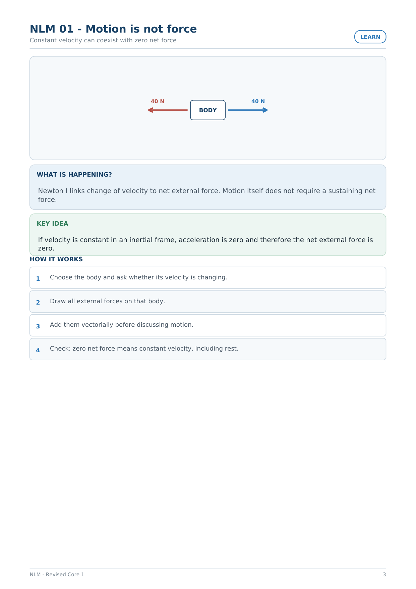
Diagram: A central box labeled BODY with a leftward arrow labeled 40 N and a rightward arrow labeled 40 N.

<!-- page 4 -->
Practice 01 - Motion is not force
Worked -> guided -> faded -> contrast
PRACTISE
WORKED EXAMPLE
A crate moves right at 3 m/s while 60 N right and 60 N left act on it. Fnet=0, so a=0; it continues at
constant velocity.
GUIDED TRY
A puck glides at constant velocity on an
ideal frictionless surface. What horizontal
net force is required?
Guide: name the body/system -> draw the
representation -> state the law before calculating.
FADED TRY
Change one feature of the worked example
(direction, mass, force, time, or system boundary).
Which parts of the reasoning remain valid and
which must change?
WATCH OUT
A moving object does not automatically need a forward net force.
QUICK CHECK
A puck glides at constant velocity on an ideal frictionless surface. What
horizontal net force is required?
Answer: 0 N.
NLM - Revised Core 1
4

<!-- page 5 -->
## NLM 02 - Choose the body before drawing forces
Interactions become forces only after the body is chosen
LEARN
crate
Earth
worker
floor
Interactions first; forces on the chosen body second.
WHAT IS HAPPENING?
A free-body diagram is a diagram of one chosen body. First identify what interacts with it; then draw
only the forces acting on that body.
KEY IDEA
The phrase “force on X by Y” prevents body confusion and Newton-III mistakes.
HOW IT WORKS
1
Circle the body/system being analysed.
2
List interacting bodies: Earth, surface, rope, hand, etc.
3
Convert each interaction into one force arrow on the chosen body.
4
Do not include forces the chosen body exerts on something else.
NLM - Revised Core 1
5
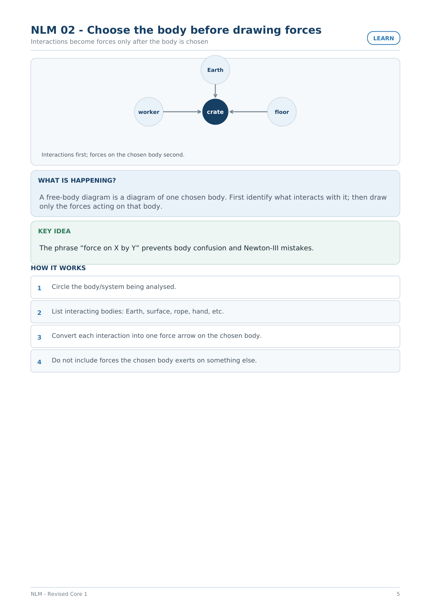
Diagram: A central circle labeled crate with inward-pointing arrows from circles labeled Earth, worker, and floor.

<!-- page 6 -->
Practice 02 - Choose the body before drawing forces
Worked -> guided -> faded -> contrast
PRACTISE
WORKED EXAMPLE
For a book on a table, the book FBD contains Earth-on-book weight and table-on-book normal. The
book-on-table force belongs to the table FBD.
GUIDED TRY
A crate is pushed by a worker while sliding
on a floor. Name three possible external
interactions on the crate.
Guide: name the body/system -> draw the
representation -> state the law before calculating.
FADED TRY
Change one feature of the worked example
(direction, mass, force, time, or system boundary).
Which parts of the reasoning remain valid and
which must change?
WATCH OUT
An interaction pair is not automatically two arrows on one FBD.
QUICK CHECK
A crate is pushed by a worker while sliding on a floor. Name three possible
external interactions on the crate.
Answer:
Worker-crate,
Earth-crate,
floor-crate.
NLM - Revised Core 1
6

<!-- page 7 -->
## NLM 03 - Net force is a vector sum
Balanced forces and no forces are different statements
LEARN
BODY
10 N
25 N
WHAT IS HAPPENING?
Newton II uses the net external force, not whichever force is easiest to notice. Balanced forces can be
nonzero individually.
KEY IDEA
Choose a positive axis, assign signs to force components, and sum them.
HOW IT WORKS
1
Choose +x and +y.
2
Resolve forces into components when needed.
3
Compute ΣFx and ΣFy.
4
Only then infer acceleration components.
NLM - Revised Core 1
7
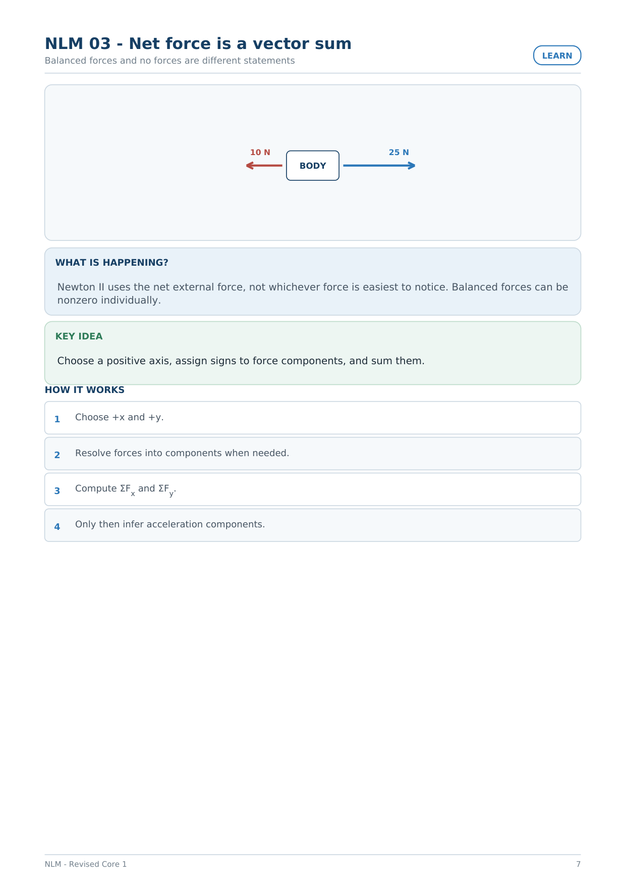
Diagram: A central box labeled BODY with a leftward arrow labeled 10 N and a rightward arrow labeled 25 N.

<!-- page 8 -->
Practice 03 - Net force is a vector sum
Worked -> guided -> faded -> contrast
PRACTISE
WORKED EXAMPLE
A cart has 25 N right and 10 N left. With right positive, Fnet,x=25-10=15 N right.
GUIDED TRY
A box has 30 N right and 30 N left. What is
its horizontal acceleration?
Guide: name the body/system -> draw the
representation -> state the law before calculating.
FADED TRY
Change one feature of the worked example
(direction, mass, force, time, or system boundary).
Which parts of the reasoning remain valid and
which must change?
WATCH OUT
Do not confuse “Fnet=0” with “there are no forces.”
QUICK CHECK
A box has 30 N right and 30 N left. What is its horizontal acceleration?
Answer: 0 m/s²,
regardless of its
current velocity.
NLM - Revised Core 1
8

<!-- page 9 -->
## NLM 04 - Newton II and scaling
Acceleration responds to net force and mass together
LEARN
F
m
a
60 N
5 kg
12 m/s²
60 N
10 kg
6 m/s²
30 N
5 kg
6 m/s²
WHAT IS HAPPENING?
For a chosen body of constant mass, Fnet=ma. At fixed mass, a scales with net force; at fixed force, a
scales inversely with mass.
KEY IDEA
For changes in both force and mass, compare ratios before substituting numbers.
HOW IT WORKS
1
Write a1=F1/m1 and a2=F2/m2.
2
Form a2/a1=(F2/F1)(m1/m2).
3
Keep direction from the signed net force.
4
Check units: 1 N = 1 kg·m/s².
NLM - Revised Core 1
9
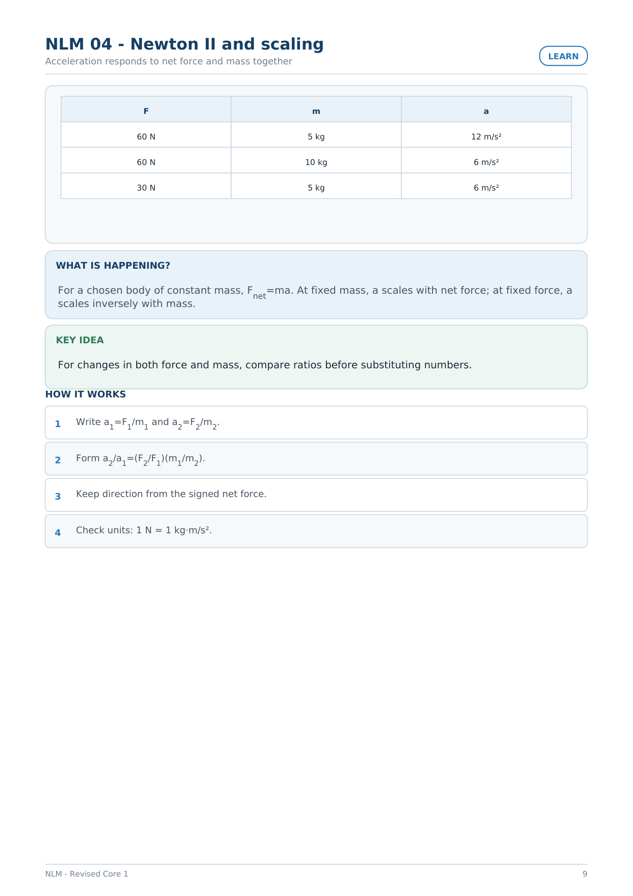
Diagram: A table with columns F, m, and a, listing values 60 N, 5 kg, 12 m/s²; 60 N, 10 kg, 6 m/s²; 30 N, 5 kg, 6 m/s².

<!-- page 10 -->
Practice 04 - Newton II and scaling
Worked -> guided -> faded -> contrast
PRACTISE
WORKED EXAMPLE
If force halves while mass doubles, a becomes (1/2)(1/2)=1/4 of its original value.
GUIDED TRY
A 40 N net force accelerates 5 kg. What is a?
Guide: name the body/system -> draw the
representation -> state the law before calculating.
FADED TRY
Change one feature of the worked example
(direction, mass, force, time, or system boundary).
Which parts of the reasoning remain valid and
which must change?
WATCH OUT
“Half the force means half the acceleration” is true only if mass is unchanged.
QUICK CHECK
A 40 N net force accelerates 5 kg. What is a?
Answer: 8 m/s².
NLM - Revised Core 1
10

<!-- page 11 -->
## NLM 05 - Stopping force needs two models
Kinematics supplies acceleration; Newton II supplies force
LEARN
u
stop over s
WHAT IS HAPPENING?
Stopping-over-distance problems often require a kinematics step before a force step. Do not jump
directly from distance to force.
KEY IDEA
For constant stopping acceleration, find a from v²=u²+2as, then use Fnet=ma; find time separately if
requested.
HOW IT WORKS
1
Write the motion state u, v=0, s.
2
Use v²=u²+2as to find a.
3
Use F=ma with sign/direction.
4
If time is needed, use v=u+at after a is known.
NLM - Revised Core 1
11
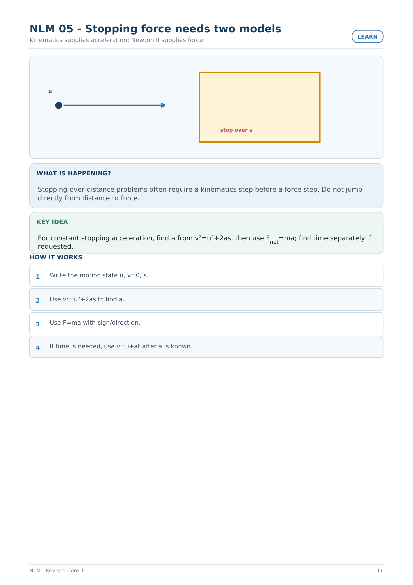
Diagram: A dot with a rightward arrow labeled u pointing toward a rectangular region labeled stop over s.

<!-- page 12 -->
Practice 05 - Stopping force needs two models
Worked -> guided -> faded -> contrast
PRACTISE
WORKED EXAMPLE
A 0.020 kg pellet at 100 m/s stops uniformly in 0.10 m. a=(0-10000)/(0.20)=-50000 m/s², so F=-1000 N.
GUIDED TRY
If the same pellet stops over twice the
distance, what happens to |a| and |F|?
Guide: name the body/system -> draw the
representation -> state the law before calculating.
FADED TRY
Change one feature of the worked example
(direction, mass, force, time, or system boundary).
Which parts of the reasoning remain valid and
which must change?
WATCH OUT
Do not mix the kinematic distance relation with Newton II as though they were one formula.
QUICK CHECK
If the same pellet stops over twice the distance, what happens to |a| and
|F|?
Answer: Both halve.
NLM - Revised Core 1
12

<!-- page 13 -->
## NLM 06 - Momentum is a signed state
Momentum carries the direction of velocity
LEARN
p vs v
slope = mass
p vs m
slope = velocity
WHAT IS HAPPENING?
Momentum is p=mv. In one dimension its sign follows velocity. A change in direction can make Δp
much larger than a simple speed difference.
KEY IDEA
Always write pi, pf, then Δp=pf-pi.
HOW IT WORKS
1
Choose a positive direction.
2
Write signed velocities.
3
Convert to signed momenta.
4
Subtract final minus initial.
NLM - Revised Core 1
13
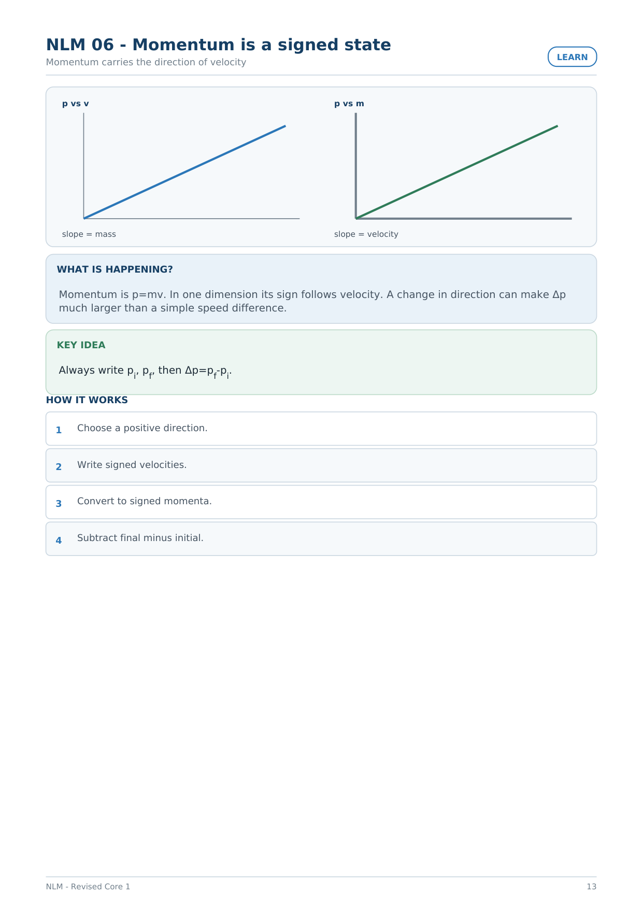
Diagram: Two linear graphs: left graph labeled p vs v with slope = mass; right graph labeled p vs m with slope = velocity.

<!-- page 14 -->
Practice 06 - Momentum is a signed state
Worked -> guided -> faded -> contrast
PRACTISE
WORKED EXAMPLE
A 0.20 kg ball changes from +8 m/s to -6 m/s. Δp=0.20(-6)-0.20(8)=-2.8 kg·m/s.
GUIDED TRY
At fixed mass, what is the shape of a p-v
graph?
Guide: name the body/system -> draw the
representation -> state the law before calculating.
FADED TRY
Change one feature of the worked example
(direction, mass, force, time, or system boundary).
Which parts of the reasoning remain valid and
which must change?
WATCH OUT
Do not discard signs when a body rebounds.
QUICK CHECK
At fixed mass, what is the shape of a p-v graph?
Answer: A straight
line through the
origin; slope = mass.
NLM - Revised Core 1
14

<!-- page 15 -->
## NLM 07 - Impulse and average force
The same momentum change can be spread over more time
LEARN
same Δp, different stopping time
short Δt → large |Favg|
long Δt → smaller |Favg|
WHAT IS HAPPENING?
Average force measures how quickly momentum changes: Favg=Δp/Δt. Increasing stopping time
reduces force magnitude for the same Δp.
KEY IDEA
This is the physics behind moving the hands backward while catching.
HOW IT WORKS
1
Find the signed Δp.
2
Identify the interaction duration Δt.
3
Divide Δp by Δt.
4
Check force direction against Δp, not against the initial velocity alone.
NLM - Revised Core 1
15
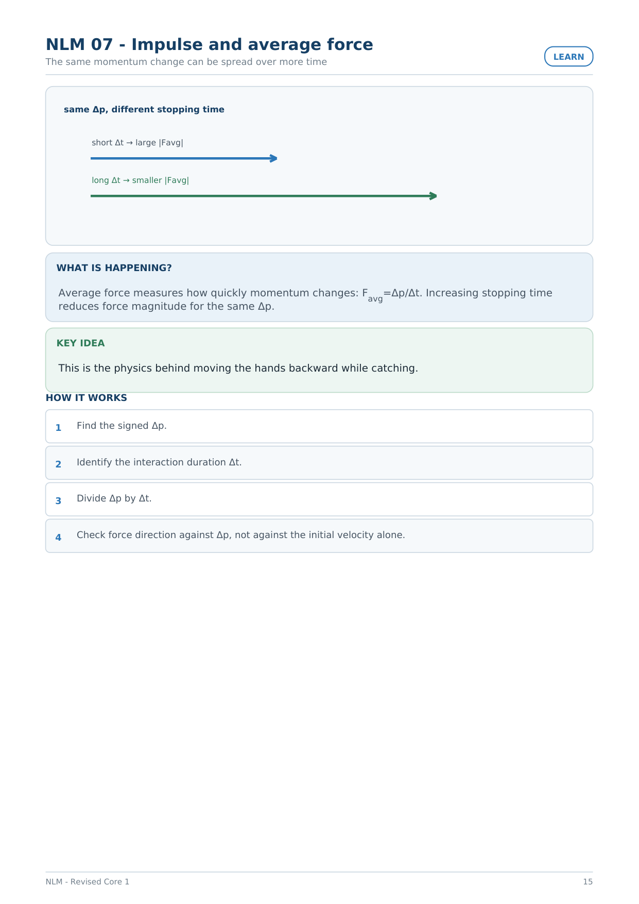
Diagram: Two rightward arrows: a shorter arrow labeled short Δt → large |Favg| and a longer arrow labeled long Δt → smaller |Favg|.

<!-- page 16 -->
Practice 07 - Impulse and average force
Worked -> guided -> faded -> contrast
PRACTISE
WORKED EXAMPLE
A 0.50 kg ball at +12 m/s stops in 0.30 s: Δp=-6 kg·m/s, Favg=-20 N.
GUIDED TRY
If the same ball is stopped in twice the time,
what happens to average force magnitude?
Guide: name the body/system -> draw the
representation -> state the law before calculating.
FADED TRY
Change one feature of the worked example
(direction, mass, force, time, or system boundary).
Which parts of the reasoning remain valid and
which must change?
WATCH OUT
Momentum and force are not the same quantity.
QUICK CHECK
If the same ball is stopped in twice the time, what happens to average
force magnitude?
Answer: It halves.
NLM - Revised Core 1
16

<!-- page 17 -->
## NLM 08 - Newton III pairs
Equal and opposite does not mean same body
LEARN
A
B
force on B by A
force on A by B
WHAT IS HAPPENING?
A third-law pair belongs to the same interaction, has equal magnitude and opposite direction, and
acts on different bodies.
KEY IDEA
Use complete names: force on B by A; force on A by B.
HOW IT WORKS
1
Name both interacting bodies.
2
Write the two force names.
3
Place each force on the correct body’s FBD.
4
Use Newton II separately to compare accelerations.
NLM - Revised Core 1
17
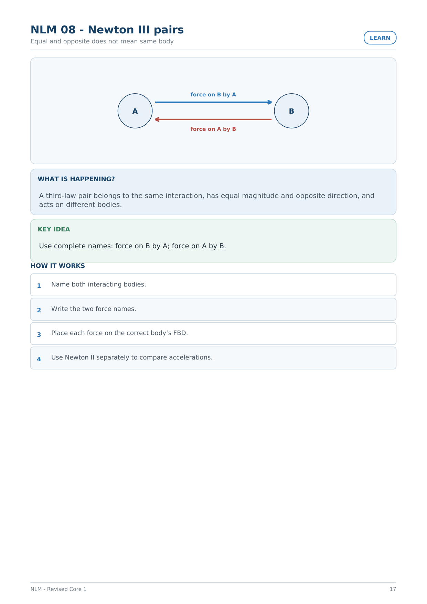
Diagram: Two circles labeled A and B with opposing arrows labeled force on B by A and force on A by B.

<!-- page 18 -->
Practice 08 - Newton III pairs
Worked -> guided -> faded -> contrast
PRACTISE
WORKED EXAMPLE
Earth pulls an apple downward with the same force magnitude that the apple pulls Earth upward. Their
accelerations differ because their masses differ.
GUIDED TRY
What is the third-law partner of the
table-on-book normal force?
Guide: name the body/system -> draw the
representation -> state the law before calculating.
FADED TRY
Change one feature of the worked example
(direction, mass, force, time, or system boundary).
Which parts of the reasoning remain valid and
which must change?
WATCH OUT
Weight and normal on a resting book are balanced forces on one body, not a Newton-III pair.
QUICK CHECK
What is the third-law partner of the table-on-book normal force?
Answer: The
book-on-table
contact force.
NLM - Revised Core 1
18

<!-- page 19 -->
## NLM 09 - Momentum conservation is a system statement
Choose the system and check external impulse first
LEARN
SYSTEM
Check external impulse before conserving total momentum.
WHAT IS HAPPENING?
Total momentum is conserved only for a chosen system when the relevant external impulse over the
interaction is negligible.
KEY IDEA
The equation pbefore,total=pafter,total comes after the system/interval check.
HOW IT WORKS
1
Draw a system boundary.
2
Choose a positive direction.
3
List all system momenta before and after.
4
Check external impulse; then equate totals if valid.
NLM - Revised Core 1
19
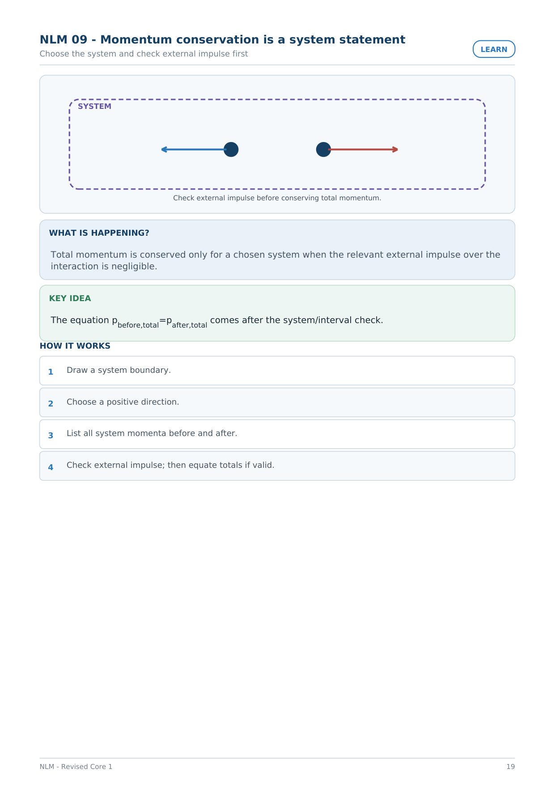
Diagram: A dashed boundary labeled SYSTEM containing two dots with arrows pointing away from each other in opposite directions.

<!-- page 20 -->
Practice 09 - Momentum conservation is a system statement
Worked -> guided -> faded -> contrast
PRACTISE
WORKED EXAMPLE
Two skaters push apart from rest. For the two-skater system, initial total p=0, so their final momenta
are equal in magnitude and opposite in direction.
GUIDED TRY
A falling ball speeds up under gravity. Is the
ball-only momentum conserved?
Guide: name the body/system -> draw the
representation -> state the law before calculating.
FADED TRY
Change one feature of the worked example
(direction, mass, force, time, or system boundary).
Which parts of the reasoning remain valid and
which must change?
WATCH OUT
Do not claim conservation from one object’s momentum alone when an external force acts on it.
QUICK CHECK
A falling ball speeds up under gravity. Is the ball-only momentum
conserved?
Answer: No; gravity
gives the ball
external impulse.
NLM - Revised Core 1
20

<!-- page 21 -->
## NLM 10 - Recoil, rockets and exchanged momentum
Equal momentum can mean very different speeds
LEARN
bullet +p
rifle -p
WHAT IS HAPPENING?
In recoil/explosion problems with negligible external impulse, momentum exchanged internally
appears with opposite signs.
KEY IDEA
For equal momentum magnitude, speed is inversely proportional to mass.
HOW IT WORKS
1
Choose launcher+projectile (or rocket+exhaust) as the system.
2
Set initial total momentum.
3
Assign opposite signs after separation.
4
Solve one object’s speed from total momentum conservation.
NLM - Revised Core 1
21
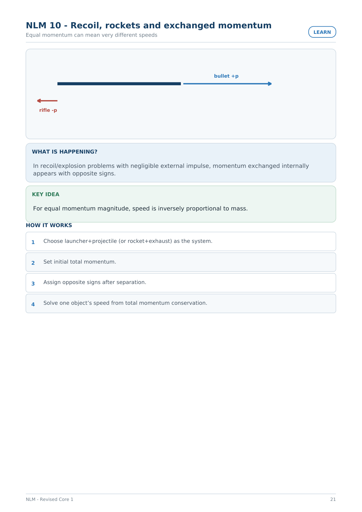
Diagram: A horizontal bar with a rightward arrow labeled bullet +p and a shorter leftward arrow labeled rifle -p.

<!-- page 22 -->
Practice 10 - Recoil, rockets and exchanged momentum
Worked -> guided -> faded -> contrast
PRACTISE
WORKED EXAMPLE
A 0.020 kg bullet leaves a 2.0 kg pistol at +150 m/s from rest. 0=(0.020)(150)+2v, so v=-1.5 m/s.
GUIDED TRY
Two rifles fire identical bullets with the
same bullet momentum. Which rifle has
larger recoil speed?
Guide: name the body/system -> draw the
representation -> state the law before calculating.
FADED TRY
Change one feature of the worked example
(direction, mass, force, time, or system boundary).
Which parts of the reasoning remain valid and
which must change?
WATCH OUT
A lighter rifle recoils faster for the same bullet momentum, not with a larger recoil momentum.
QUICK CHECK
Two rifles fire identical bullets with the same bullet momentum. Which
rifle has larger recoil speed?
Answer: The lighter
rifle.
NLM - Revised Core 1
22

<!-- page 23 -->
## NLM 11 - Read force from a motion graph
v-t slope → acceleration → force
LEARN
t
v
80
8 s
slope = acceleration → friction force if friction is the only horizontal force
WHAT IS HAPPENING?
A velocity-time graph gives acceleration from its slope. If friction is the only horizontal force, then
Ffriction=ma.
KEY IDEA
The graph height is velocity; the slope is acceleration.
HOW IT WORKS
1
Read two points on the straight segment.
2
Compute a=Δv/Δt.
3
Convert mass to kilograms.
4
Apply F=ma and interpret the sign.
NLM - Revised Core 1
23
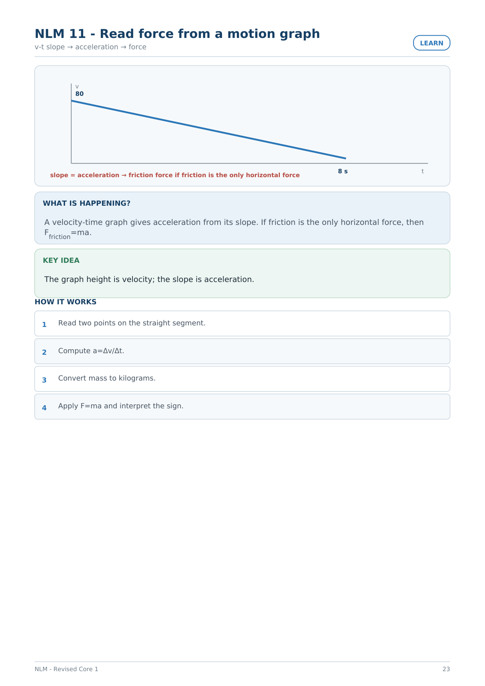
Diagram: A velocity-time graph showing a line descending from 80 on the vertical axis to 8 s on the horizontal axis.

<!-- page 24 -->
Practice 11 - Read force from a motion graph
Worked -> guided -> faded -> contrast
PRACTISE
WORKED EXAMPLE
A 50 g object slows from 80 m/s to 0 in 8 s. a=-10 m/s²; F=0.050(-10)=-0.50 N.
GUIDED TRY
If the same velocity change takes twice as
long, what happens to |a| and |F|?
Guide: name the body/system -> draw the
representation -> state the law before calculating.
FADED TRY
Change one feature of the worked example
(direction, mass, force, time, or system boundary).
Which parts of the reasoning remain valid and
which must change?
WATCH OUT
Do not use the area under a v-t graph when the question asks for acceleration or force.
QUICK CHECK
If the same velocity change takes twice as long, what happens to |a| and
|F|?
Answer: Both halve.
NLM - Revised Core 1
24

<!-- page 25 -->
First-move atlas
Use this after learning; it is not a formula sheet
REVISED CORE 1
WHEN YOU SEE...
FIRST REPRESENTATION
FIRST PHYSICS MOVE
constant velocity / rest
one-body FBD
test whether ΣF=0
force question
choose body + interactions
draw only forces on that body
several forces
signed component sum
find Fnet before ma
force/mass change
old/new state ratio
compare F/m
stopping over distance
kinematic state
find a first, then F=ma
catch / collision time
signed p states
Δp then Δp/Δt
action-reaction
two-body interaction pair
force on B by A ↔ force on A by B
collision / recoil
system boundary
check external impulse, then conserve
total p
rocket / rifle
opposite signed momenta
lighter mass → larger speed for same |p|
v-t friction graph
graph slope
a=Δv/Δt then F=ma
p-v or p-m graph
read axes + slope
slope gives m or v
NLM - Revised Core 1
25
