<!-- page 1 -->
NEWTON'S LAWS OF MOTION - Revised Core 2
20 source-demand transfer challenges with paired prompt/reveal hints
REVISED CORE 2
Attempt first. Each hint is a question before it is a reveal. H1 asks for the decisive
physics, H2 asks for the representation, and H3 asks for the first mathematical or logical
constraint. The reveal must answer only that rung.
H1 - What is the key physics?
Event, state, force/body ownership, system boundary, direction, or invariant.
H2 - How would you represent it?
FBD, interaction pair, momentum state, graph, system boundary, or signed axis.
H3 - What would you write first?
One starting equation/constraint only; no final-result leakage.
NLM - Revised Core 2
1

<!-- page 2 -->
## Q01 - Changing velocity means net force
Attempt page - answer protected
CHALLENGE
QUESTION
A trolley moves to the right and its speed increases steadily. Which statement about the
horizontal net force is necessarily true?
trolley
v →
a →
HINT 1 - WHAT IS THE KEY PHYSICS?
The trolley is moving right and speeding up. What does that tell you about the direction of
its acceleration?
REVEAL
Its acceleration points to the right, the same direction as the velocity while the speed increases.
HINT 2 - HOW WOULD YOU REPRESENT IT?
For one chosen trolley, what representation connects that acceleration to the forces
acting on it?
REVEAL
Draw the trolley FBD and form the horizontal vector sum ΣFₓ.
HINT 3 - WHAT WOULD YOU WRITE FIRST?
What law would you write first after determining the acceleration direction?
REVEAL
Write ΣFₓ = maₓ. Use the acceleration direction from H1 only after you have written the law.
YOUR WORK
NLM - Revised Core 2
2
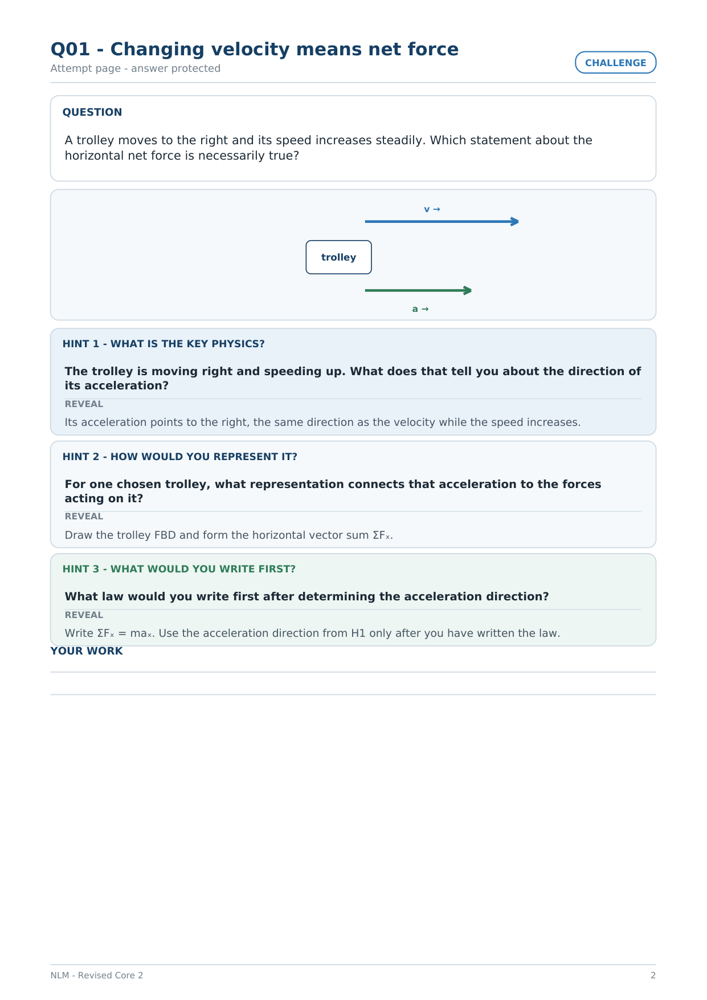
Diagram: A box labeled trolley with a rightward arrow labeled v → and another rightward arrow labeled a →.

<!-- page 3 -->
## Q02 - Identify the Newton-III pair
Attempt page - answer protected
CHALLENGE
QUESTION
A student pushes a wall horizontally with 120 N. What force does the wall exert on the student?
A
B
force on B by A
force on A by B
HINT 1 - WHAT IS THE KEY PHYSICS?
The student and wall are one interaction pair. What does Newton III say about the two
interaction forces?
REVEAL
They are equal in magnitude, opposite in direction, and act on different bodies.
HINT 2 - HOW WOULD YOU REPRESENT IT?
How would you label the pair so body ownership cannot be confused?
REVEAL
Use “force on wall by student” and “force on student by wall”.
HINT 3 - WHAT WOULD YOU WRITE FIRST?
If the student-on-wall force is +120 N, what relation would you write first for the
wall-on-student force?
REVEAL
F_student by wall = -F_wall by student.
YOUR WORK
NLM - Revised Core 2
3

Diagram: Two circles labeled A and B with opposing arrows labeled force on B by A and force on A by B.

<!-- page 4 -->
## Q03 - Catching time and average force
Attempt page - answer protected
CHALLENGE
QUESTION
A 0.40 kg ball moving at 15 m/s is brought to rest. Compare the average force magnitude if it is
stopped in 0.10 s versus 0.30 s.
same Δp, different stopping time
short Δt → large |Favg|
long Δt → smaller |Favg|
HINT 1 - WHAT IS THE KEY PHYSICS?
The initial and final momenta are the same in both catches. What quantity changes
between the two cases?
REVEAL
Only the stopping time changes; the momentum change is the same.
HINT 2 - HOW WOULD YOU REPRESENT IT?
Which state representation makes the sign and size of the momentum change explicit?
REVEAL
Write pᵢ=mvᵢ, p_f=0, then Δp=p_f-pᵢ for each case.
HINT 3 - WHAT WOULD YOU WRITE FIRST?
What force relation would you write first once Δp is known?
REVEAL
F_avg = Δp/Δt.
YOUR WORK
NLM - Revised Core 2
4
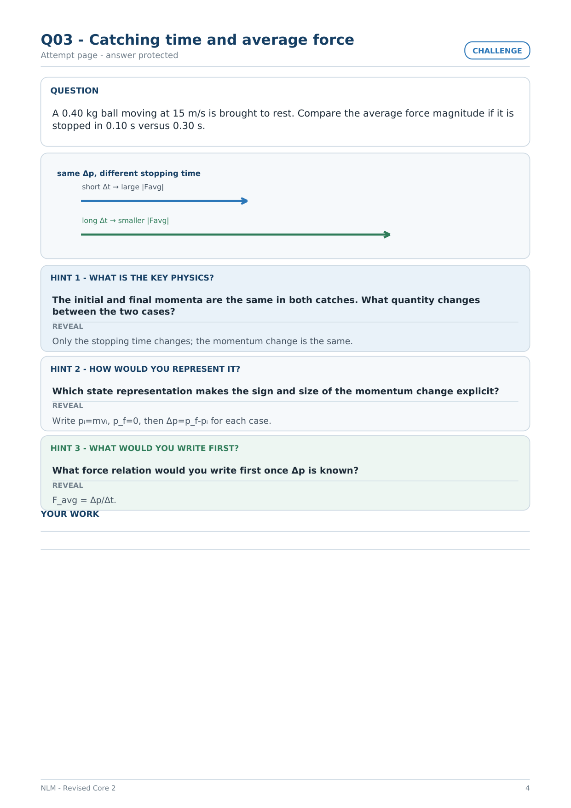
Diagram: Two rightward arrows: a shorter arrow labeled short Δt → large |Favg| and a longer arrow labeled long Δt → smaller |Favg|.

<!-- page 5 -->
## Q04 - Inertia during sudden braking
Attempt page - answer protected
CHALLENGE
QUESTION
A standing passenger in a bus lurches forward when the bus brakes suddenly. Explain the effect
without inventing a forward force of inertia.
vehicle acceleration ←
passenger tends to continue →
HINT 1 - WHAT IS THE KEY PHYSICS?
Immediately before braking, what horizontal velocity does the passenger’s upper body
already have?
REVEAL
It has the same forward velocity as the bus.
HINT 2 - HOW WOULD YOU REPRESENT IT?
When the bus floor slows the passenger’s feet, what representation separates the
foot-contact effect from the upper body’s tendency to continue?
REVEAL
Compare the passenger parts/body state with the braking bus: contact changes the supported part first
while the upper body retains forward velocity momentarily.
HINT 3 - WHAT WOULD YOU WRITE FIRST?
Which Newton-law idea would you state first?
REVEAL
Newton I: without enough backward external impulse, the body tends to retain its current velocity.
YOUR WORK
NLM - Revised Core 2
5
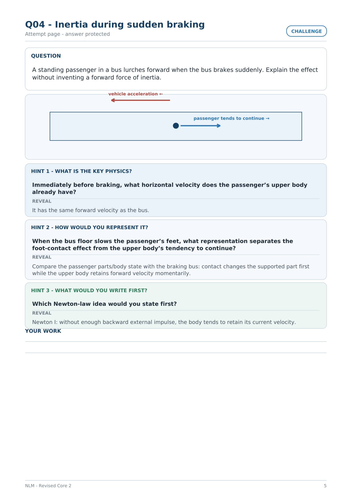
Diagram: A leftward arrow labeled vehicle acceleration ← and a rightward arrow labeled passenger tends to continue →.

<!-- page 6 -->
## Q05 - Coin tossed in an accelerating train
Attempt page - answer protected
CHALLENGE
QUESTION
Inside a train accelerating forward, a passenger tosses a coin vertically. Relative to the
passenger, where does the coin tend to land?
train accelerates →
Airborne coin keeps its prior horizontal velocity while train gains speed.
HINT 1 - WHAT IS THE KEY PHYSICS?
While the coin is airborne, does it automatically share the train’s continuing forward
acceleration?
REVEAL
No. Once released, it retains its horizontal velocity at release unless a horizontal force acts.
HINT 2 - HOW WOULD YOU REPRESENT IT?
How would you compare train and coin horizontal motion during the same flight time?
REVEAL
Draw two horizontal state tracks: the train gains forward speed; the coin keeps approximately constant
horizontal speed.
HINT 3 - WHAT WOULD YOU WRITE FIRST?
What relative-motion statement would you make first at landing time?
REVEAL
Compare x_train(t) and x_coin(t) at the same landing time; the sign of x_coin-x_train gives the relative
landing position.
YOUR WORK
NLM - Revised Core 2
6
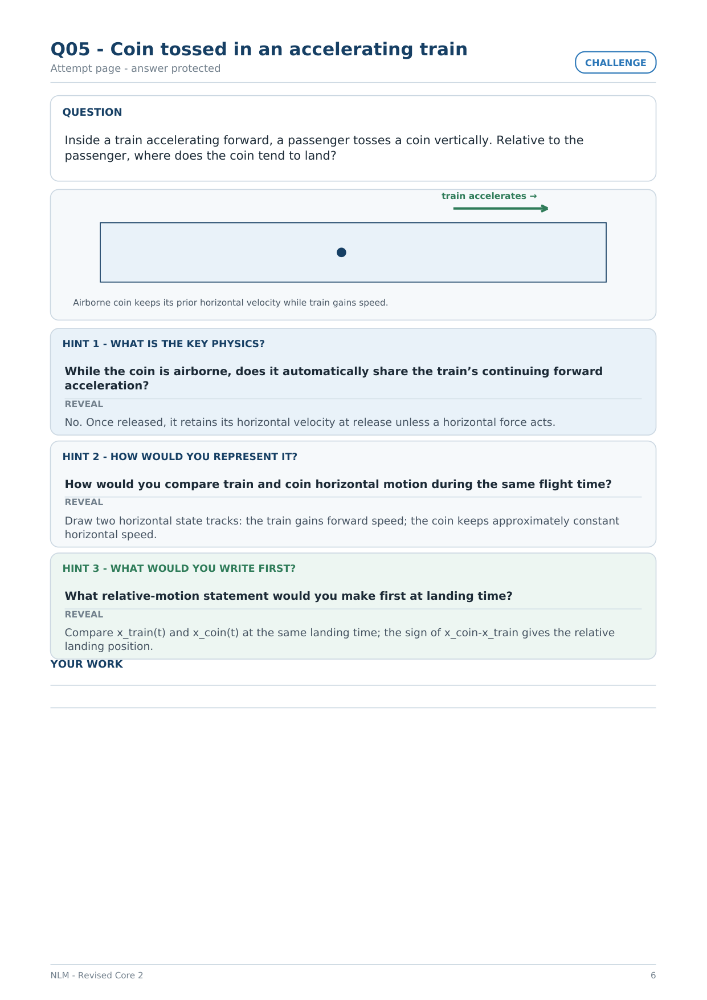
Diagram: A rightward arrow labeled train accelerates → above a box with a dot, captioned Airborne coin keeps its prior horizontal velocity.

<!-- page 7 -->
## Q06 - Constant velocity on a frictionless table
Attempt page - answer protected
CHALLENGE
QUESTION
A puck slides at constant velocity on a perfectly frictionless horizontal table. What horizontal
force is needed to keep it moving?
constant v
N
mg
No horizontal force arrow is needed on the ideal frictionless puck.
HINT 1 - WHAT IS THE KEY PHYSICS?
The puck’s velocity is constant. What is its acceleration?
REVEAL
Zero.
HINT 2 - HOW WOULD YOU REPRESENT IT?
What does a one-body FBD say about the horizontal net force when a=0?
REVEAL
The horizontal vector sum must be zero.
HINT 3 - WHAT WOULD YOU WRITE FIRST?
Which law connects that conclusion to motion?
REVEAL
Write ΣFₓ = maₓ. Then use the constant-velocity condition to supply aₓ.
YOUR WORK
NLM - Revised Core 2
7
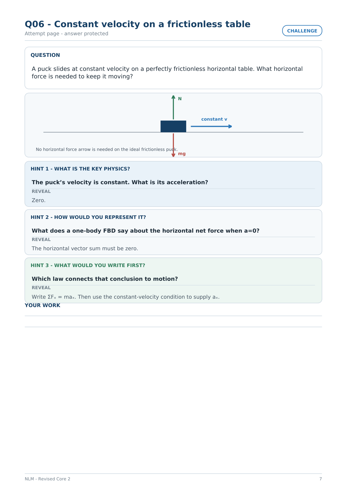
Diagram: A block on a horizontal line with an upward arrow N, a downward arrow mg, and a rightward arrow labeled constant v.

<!-- page 8 -->
## Q07 - Rocket propulsion and momentum
Attempt page - answer protected
CHALLENGE
QUESTION
A rocket ejects exhaust backward in deep space. Explain why the rocket accelerates forward.
rocket
exhaust
HINT 1 - WHAT IS THE KEY PHYSICS?
Which two parts exchange momentum during the short ejection event?
REVEAL
Rocket and exhaust.
HINT 2 - HOW WOULD YOU REPRESENT IT?
What system boundary lets the internal exchange be seen without an external
horizontal/axial force?
REVEAL
Choose rocket + expelled exhaust over the short ejection interval.
HINT 3 - WHAT WOULD YOU WRITE FIRST?
What momentum relation would you write first for an initially at-rest simplified system?
REVEAL
0 = p_rocket + p_exhaust, with opposite signs.
YOUR WORK
NLM - Revised Core 2
8
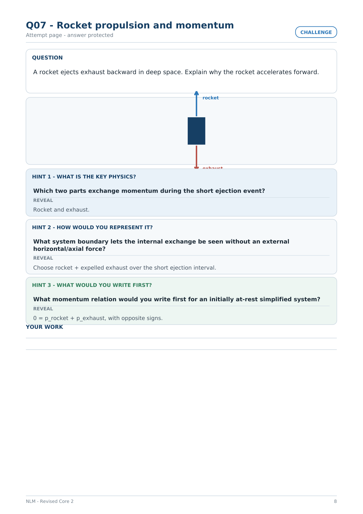
Diagram: A rectangular body with an upward arrow labeled rocket and a downward arrow labeled exhaust.

<!-- page 9 -->
## Q08 - Water tanker braking and inertia
Attempt page - answer protected
CHALLENGE
QUESTION
A partly filled tanker brakes suddenly. Why does the water surge toward the front?
vehicle acceleration ←
water tends to continue →
HINT 1 - WHAT IS THE KEY PHYSICS?
Before braking, what velocity does the water already have relative to the road?
REVEAL
Approximately the tanker’s forward velocity.
HINT 2 - HOW WOULD YOU REPRESENT IT?
When the tanker body decelerates, what physical comparison should you make between
the container and the water?
REVEAL
The container is forced to slow by the brakes/road; the water tends to retain its forward velocity until
wall/fluid forces change it.
HINT 3 - WHAT WOULD YOU WRITE FIRST?
Which Newton-law idea would you state first?
REVEAL
Newton I: matter resists a change of velocity.
YOUR WORK
NLM - Revised Core 2
9
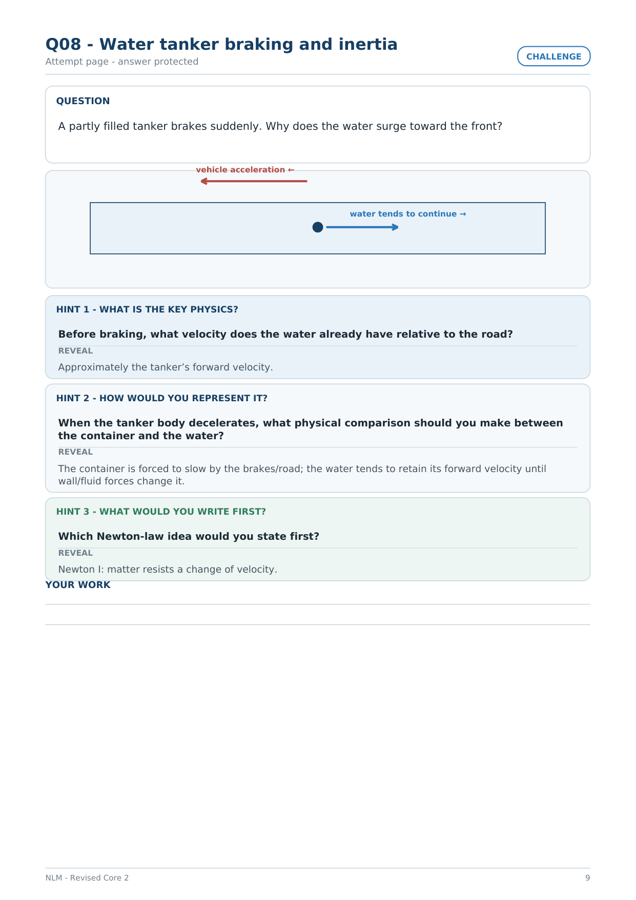
Diagram: A leftward arrow labeled vehicle acceleration ← above a box with a dot and a rightward arrow labeled water tends to continue →.

<!-- page 10 -->
## Q09 - Mass as a measure of inertia
Attempt page - answer protected
CHALLENGE
QUESTION
Three blocks have the same shape but masses 1 kg, 3 kg and 5 kg. Rank their inertia.
1 kg
3 kg
5 kg
larger mass → greater translational inertia
HINT 1 - WHAT IS THE KEY PHYSICS?
What property measures resistance to a change in velocity in translational motion?
REVEAL
Mass.
HINT 2 - HOW WOULD YOU REPRESENT IT?
How would you represent the comparison without using a force calculation?
REVEAL
Use a simple mass ranking: larger mass → greater inertia.
HINT 3 - WHAT WOULD YOU WRITE FIRST?
What inequality would you write first?
REVEAL
Write the mass order first: 5 kg > 3 kg > 1 kg. Then state separately how inertia tracks mass.
YOUR WORK
NLM - Revised Core 2
10
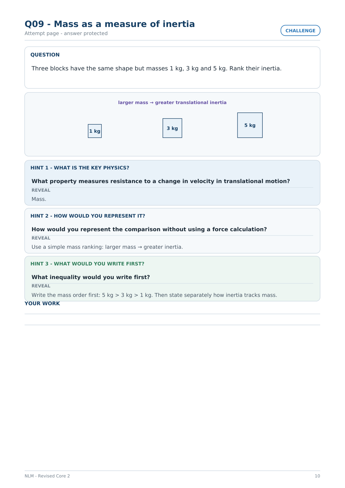
Diagram: Three square boxes labeled 1 kg, 3 kg, and 5 kg in increasing size below a label larger mass → greater translational inertia.

<!-- page 11 -->
## Q10 - Ambiguous rolling claim on a smooth train floor
Attempt page - answer protected
CHALLENGE
QUESTION
A source question places balls on a “smooth” train floor during braking and asks about rolling.
Under the literal ideal-frictionless interpretation, what can and cannot be concluded?
train brakes ←
Ideal smooth floor: vertical N and mg only; no horizontal frictional torque.
HINT 1 - WHAT IS THE KEY PHYSICS?
If the floor is truly frictionless, what horizontal contact force and rolling torque can it exert
on a ball?
REVEAL
No horizontal friction force and therefore no frictional rolling torque.
HINT 2 - HOW WOULD YOU REPRESENT IT?
What representation separates translational inertia from rotational rolling?
REVEAL
Draw the ball with vertical N and mg only; there is no horizontal friction arrow in the ideal smooth-floor
model.
HINT 3 - WHAT WOULD YOU WRITE FIRST?
What conclusion would you write first before discussing the source’s intended inertia
idea?
REVEAL
Start with ΣFₓ=0 and τ_contact=0 for the literal ideal-frictionless contact. Only then decide what motion is
supported.
YOUR WORK
NLM - Revised Core 2
11
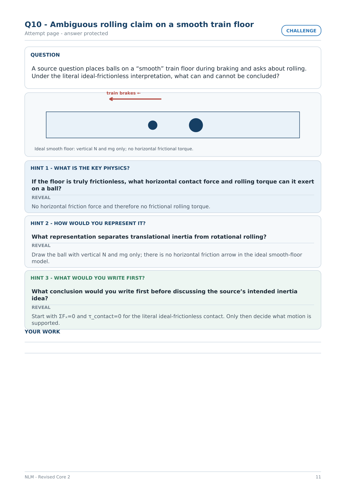
Diagram: A leftward arrow labeled train brakes ← above a box containing two circular balls of different sizes on a smooth floor.

<!-- page 12 -->
## Q11 - Light and heavy rifle recoil
Attempt page - answer protected
CHALLENGE
QUESTION
Two rifles fire bullets with the same forward momentum. One rifle has half the mass of the other.
Compare their recoil momenta and recoil speeds.
bullet +p
rifle -p
HINT 1 - WHAT IS THE KEY PHYSICS?
For rifle+bullet systems initially at rest, what must the rifle momentum do when the bullet
gets forward momentum?
REVEAL
It must have equal-magnitude opposite momentum, if external impulse is negligible during firing.
HINT 2 - HOW WOULD YOU REPRESENT IT?
If both rifles have the same recoil momentum magnitude, which quantity controls their
recoil speed?
REVEAL
v = p/M, so mass controls the speed for fixed momentum.
HINT 3 - WHAT WOULD YOU WRITE FIRST?
What ratio would you write first for the recoil speeds?
REVEAL
v_light/v_heavy = M_heavy/M_light.
YOUR WORK
NLM - Revised Core 2
12
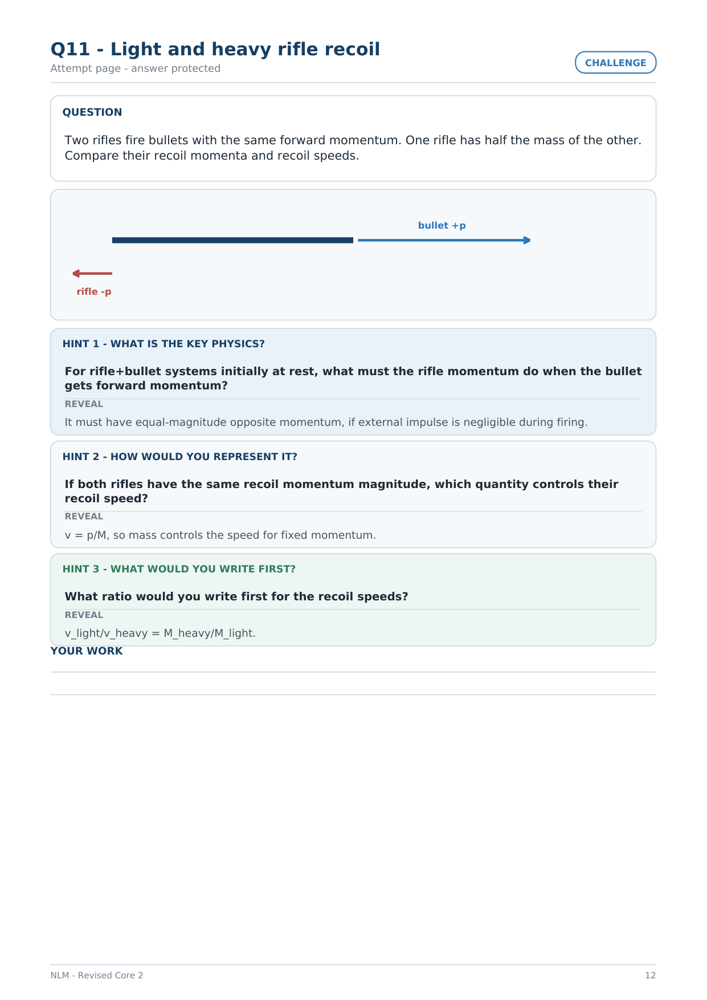
Diagram: A horizontal bar with a rightward arrow labeled bullet +p and a shorter leftward arrow labeled rifle -p.

<!-- page 13 -->
## Q12 - Horse and cart at constant speed
Attempt page - answer protected
CHALLENGE
QUESTION
A horse pulls a cart at constant speed on a level road. The horse pulls forward on the cart with
500 N. What must the total backward resistance on the cart be?
cart
500 N
R
HINT 1 - WHAT IS THE KEY PHYSICS?
The cart moves at constant velocity. What does that say about its acceleration and net
force?
REVEAL
Both are zero.
HINT 2 - HOW WOULD YOU REPRESENT IT?
Which body should the FBD contain if the question asks about resistance on the cart?
REVEAL
The cart only: forward horse-on-cart force and backward resistive forces.
HINT 3 - WHAT WOULD YOU WRITE FIRST?
What horizontal balance equation would you write first?
REVEAL
ΣFₓ = 500 - R = 0.
YOUR WORK
NLM - Revised Core 2
13
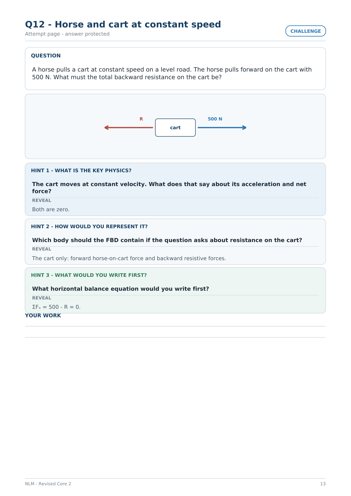
Diagram: A central box labeled cart with a leftward arrow labeled R and a rightward arrow labeled 500 N.

<!-- page 14 -->
## Q13 - Why a falling ball alone does not conserve momentum
Attempt page - answer protected
CHALLENGE
QUESTION
A ball falls freely and its downward momentum increases. Can you say the ball’s momentum is
conserved because the initial and final momentum happen to have some matching magnitude in
two observations?
gravity crosses boundary
ball-only system
HINT 1 - WHAT IS THE KEY PHYSICS?
What external force acts on the ball-only system during the fall?
REVEAL
Gravity.
HINT 2 - HOW WOULD YOU REPRESENT IT?
How would a system boundary around only the ball affect the conservation test?
REVEAL
Gravity crosses the boundary as an external interaction and gives external impulse.
HINT 3 - WHAT WOULD YOU WRITE FIRST?
What conservation check must be written before comparing momenta?
REVEAL
Write the conservation test first: is the external impulse on the chosen ball-only system negligible over the
interval?
YOUR WORK
NLM - Revised Core 2
14
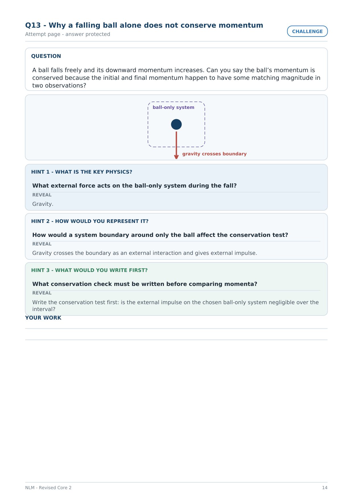
Diagram: A dashed boundary labeled ball-only system containing a circular ball with a downward arrow labeled gravity crosses boundary.

<!-- page 15 -->
## Q14 - Friction from a velocity-time graph
Attempt page - answer protected
CHALLENGE
QUESTION
A 50 g slider slows uniformly from 80 m/s to rest in 8 s. If friction is the only horizontal force, find
the friction force.
t
v
80
8 s
slope = acceleration → friction force if friction is the only horizontal force
HINT 1 - WHAT IS THE KEY PHYSICS?
The graph is velocity versus time. What physical quantity is the slope?
REVEAL
Acceleration.
HINT 2 - HOW WOULD YOU REPRESENT IT?
How would you represent the mass before using Newton II?
REVEAL
Convert 50 g to 0.050 kg and use the signed graph slope for a.
HINT 3 - WHAT WOULD YOU WRITE FIRST?
What slope would you write first?
REVEAL
a=(0-80)/(8-0).
YOUR WORK
NLM - Revised Core 2
15
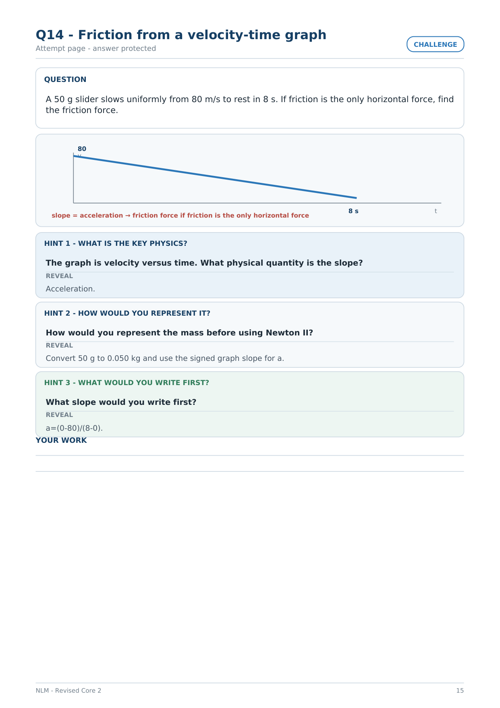
Diagram: A velocity-time graph showing a line descending from 80 on the vertical axis to 8 s on the horizontal axis.

<!-- page 16 -->
## Q15 - Force-mass scaling
Attempt page - answer protected
CHALLENGE
QUESTION
An object accelerates at a under net force F and mass m. The force becomes F/2 while the mass
becomes 2m. What is the new acceleration?
state
Fnet
mass
acceleration
old
F
m
a
new
F/2
2m
?
HINT 1 - WHAT IS THE KEY PHYSICS?
Both numerator and denominator of a=F/m change. Which way does each change push the
acceleration?
REVEAL
Halving force halves a; doubling mass halves it again.
HINT 2 - HOW WOULD YOU REPRESENT IT?
How would you represent the old and new states without assigning numbers?
REVEAL
a₁=F/m and a₂=(F/2)/(2m).
HINT 3 - WHAT WOULD YOU WRITE FIRST?
What ratio would you write first?
REVEAL
a₂/a₁=(1/2)(1/2).
YOUR WORK
NLM - Revised Core 2
16
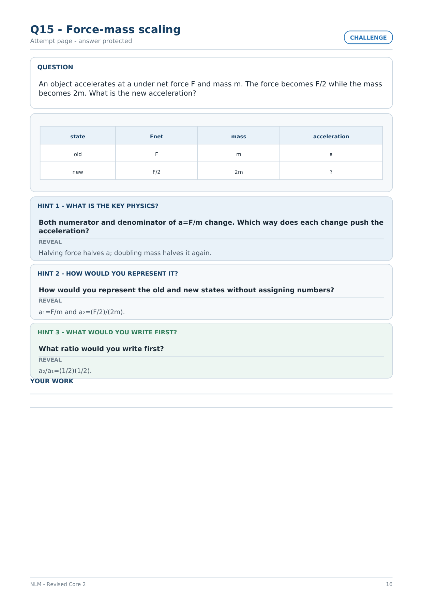
Diagram: A table with columns state, Fnet, mass, acceleration listing rows old: F, m, a and new: F/2, 2m, ?.

<!-- page 17 -->
## Q16 - Skaters push apart
Attempt page - answer protected
CHALLENGE
QUESTION
Two skaters of masses 50 kg and 75 kg push apart from rest. The 50 kg skater moves left at 3
m/s. Find the velocity of the 75 kg skater.
SYSTEM
Check external impulse before conserving total momentum.
HINT 1 - WHAT IS THE KEY PHYSICS?
For the two-skater system initially at rest, what is the total momentum before they push?
REVEAL
Zero.
HINT 2 - HOW WOULD YOU REPRESENT IT?
How would you encode opposite directions so momentum conservation can be used
without losing direction?
REVEAL
Choose right positive: v₁=-3 m/s for the left-moving 50 kg skater; v₂ is unknown.
HINT 3 - WHAT WOULD YOU WRITE FIRST?
What momentum equation would you write first?
REVEAL
0 = 50(-3) + 75v₂.
YOUR WORK
NLM - Revised Core 2
17
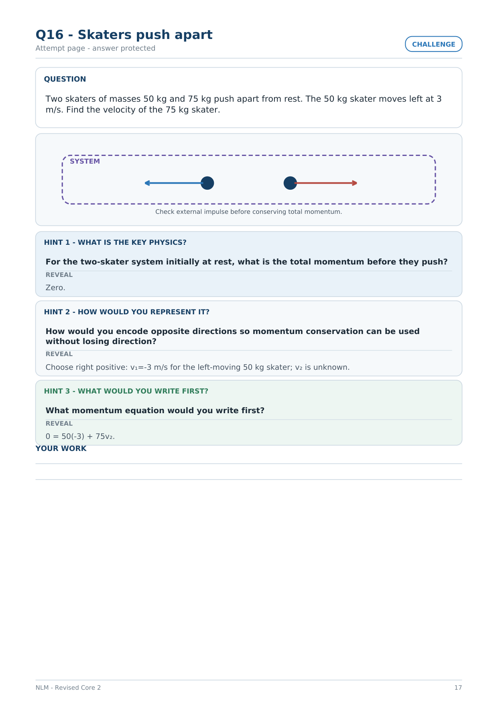
Diagram: A dashed boundary labeled SYSTEM containing two dots with opposing arrows pointing away from each other.

<!-- page 18 -->
## Q17 - Sprinkler reaction
Attempt page - answer protected
CHALLENGE
QUESTION
A sprinkler ejects water tangentially backward from its nozzles. Why does the sprinkler rotate in
the opposite sense?
A
B
force on B by A
force on A by B
HINT 1 - WHAT IS THE KEY PHYSICS?
What body exerts the force that accelerates the outgoing water?
REVEAL
The sprinkler/nozzle exerts a force on the water.
HINT 2 - HOW WOULD YOU REPRESENT IT?
What is the Newton-III partner of that force and on which body does it act?
REVEAL
Water exerts an equal-and-opposite force on the sprinkler.
HINT 3 - WHAT WOULD YOU WRITE FIRST?
What directional statement would you write first for the pair?
REVEAL
F_on sprinkler by water = -F_on water by sprinkler.
YOUR WORK
NLM - Revised Core 2
18
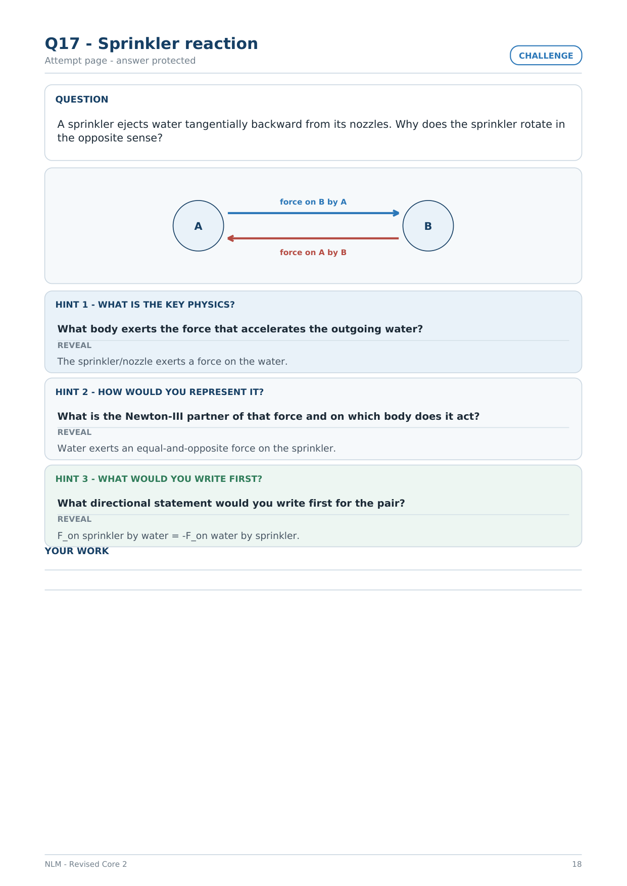
Diagram: Two circles labeled A and B with opposing arrows labeled force on B by A and force on A by B.

<!-- page 19 -->
## Q18 - Bullet stopping force and time
Attempt page - answer protected
CHALLENGE
QUESTION
A 0.020 kg bullet enters a block at 100 m/s and stops uniformly in 0.10 m. Find the average
stopping force and stopping time.
u
stop over s
HINT 1 - WHAT IS THE KEY PHYSICS?
Distance is given but acceleration is not. Which model must be used before Newton II?
REVEAL
Constant-acceleration kinematics.
HINT 2 - HOW WOULD YOU REPRESENT IT?
What motion state would you write so the acceleration can be found without time?
REVEAL
u=100 m/s, v=0, s=0.10 m; use v²=u²+2as.
HINT 3 - WHAT WOULD YOU WRITE FIRST?
What equation would you write first?
REVEAL
0 = 100² + 2a(0.10).
YOUR WORK
NLM - Revised Core 2
19
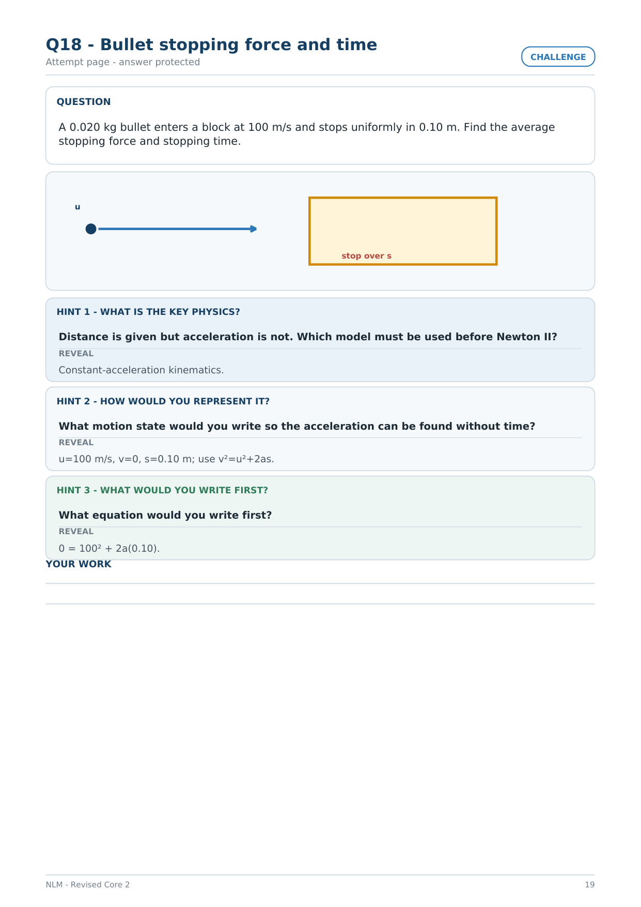
Diagram: A dot with a rightward arrow labeled u pointing toward a rectangular region labeled stop over s.

<!-- page 20 -->
## Q19 - Combined masses under the same force
Attempt page - answer protected
CHALLENGE
QUESTION
A 5 N force gives mass m₁ acceleration 8 m/s² and mass m₂ acceleration 24 m/s². If the masses
are tied together and the same 5 N net force acts, find the acceleration.
case
F
a
m=F/a
1
5 N
8 m/s²
5/8 kg
2
5 N
24 m/s²
5/24 kg
HINT 1 - WHAT IS THE KEY PHYSICS?
The same force produces different accelerations. What does F=ma let you infer about each
mass?
REVEAL
m=F/a, so the smaller acceleration belongs to the larger mass.
HINT 2 - HOW WOULD YOU REPRESENT IT?
How would you represent the tied system before finding its new acceleration?
REVEAL
Find m₁ and m₂ separately, then add them because both are accelerated together by the same net force.
HINT 3 - WHAT WOULD YOU WRITE FIRST?
What mass equations would you write first?
REVEAL
m₁=5/8 and m₂=5/24 kg.
YOUR WORK
NLM - Revised Core 2
20
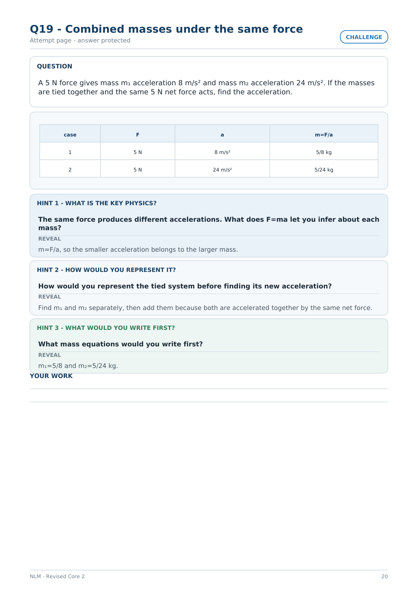
Diagram: A table comparing cases 1 and 2 with columns F, a, and m=F/a listing values 5 N, 8 m/s², and 24 m/s².

<!-- page 21 -->
## Q20 - Momentum graphs and force as rate of change
Attempt page - answer protected
CHALLENGE
QUESTION
For p=mv, what do the slopes of a p-v graph at fixed mass and a p-m graph at fixed velocity
represent? How is force related to momentum change?
p vs v
slope = mass
p vs m
slope = velocity
HINT 1 - WHAT IS THE KEY PHYSICS?
In p=mv, if m is held fixed and v varies, which quantity multiplies the horizontal-axis
variable?
REVEAL
Mass; it is the slope of p versus v.
HINT 2 - HOW WOULD YOU REPRESENT IT?
If velocity is held fixed and mass varies, what does the corresponding graph slope
become?
REVEAL
Velocity; p=vm is linear in m.
HINT 3 - WHAT WOULD YOU WRITE FIRST?
What rate equation would you write first for force in momentum language?
REVEAL
F_avg = Δp/Δt (and instantaneously F=dp/dt).
YOUR WORK
NLM - Revised Core 2
21
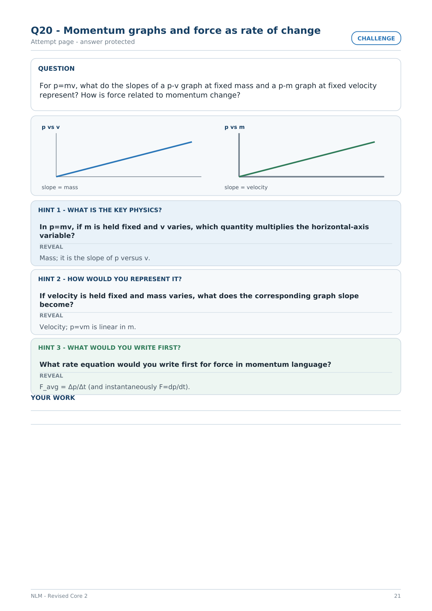
Diagram: Two linear graphs: left graph labeled p vs v with slope = mass; right graph labeled p vs m with slope = velocity.

<!-- page 22 -->
Quick Answer Key
Results only - use after attempting
CHECK
Q01
Net horizontal force points right.
Q02
120 N opposite to the push.
Q03
60 N versus 20 N; the 0.30 s catch has one-third the
force.
Q04
Passenger lurches forward because the body tends
to retain its pre-braking forward velocity.
Q05
Behind the passenger.
Q06
0 N.
Q07
Forward rocket momentum balances backward
exhaust momentum in the simplified system.
Q08
Water surges toward the front.
Q09
5 kg > 3 kg > 1 kg.
Q10
Rolling is not justified by the literal smooth-floor
model; the inertia comparison is the usable idea.
Q11
Equal recoil momentum; lighter rifle has twice the
recoil speed.
Q12
500 N backward.
Q13
No; gravity gives external impulse to the ball-only
system.
Q14
0.50 N opposite the motion.
Q15
a/4.
Q16
2 m/s to the right.
Q17
Opposite to the water jets.
Q18
1000 N opposite motion; 0.0020 s.
Q19
6 m/s².
Q20
slope(p-v)=m; slope(p-m)=v; F_avg=Δp/Δt.
NLM - Revised Core 2
22

<!-- page 23 -->
Q01 - Solution: Changing velocity means net force
Complete reasoning ladder - no skipped learner steps
SOLUTION
QUESTION RECAP
A trolley moves to the right and its speed increases steadily. Which statement about the horizontal net
force is necessarily true?
trolley
v →
a →
WHAT DO WE KNOW?
body: trolley; motion: rightward and speeding up.
REASONING LADDER
1
UNDERSTAND
The velocity magnitude is increasing to the right, so acceleration is rightward.
2
REPRESENT
Use one trolley FBD and the horizontal axis.
3
CONNECT
Newton II requires ΣFₓ=maₓ.
4
CALCULATE
Since aₓ>0, ΣFₓ>0: the net horizontal force is rightward.
5
INTERPRET
A rightward net force is required; individual forces need not all point right.
ANSWER
Net horizontal force points right.
QUICK CHECK
If the net force were zero, the velocity could not be
changing.
CHECK IT ANOTHER WAY
A leftward net force would make a right-moving
trolley slow down, not speed up.
WATCH OUT
Do not infer force direction from velocity alone; use the change of velocity.
REVIEW THIS IDEA
Core 1: NLM 01-04
NLM - Revised Core 2
23
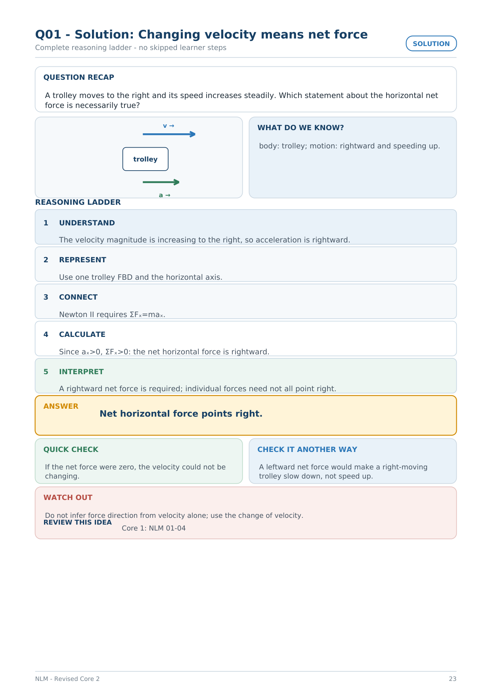
Diagram: A box labeled trolley with a rightward arrow labeled v → and another rightward arrow labeled a →.

<!-- page 24 -->
Q02 - Solution: Identify the Newton-III pair
Complete reasoning ladder - no skipped learner steps
SOLUTION
QUESTION RECAP
A student pushes a wall horizontally with 120 N. What force does the wall exert on the student?
A
B
force on B by A
force on A by B
WHAT DO WE KNOW?
interaction: student ↔ wall; applied force
magnitude 120 N.
REASONING LADDER
1
UNDERSTAND
This is one contact interaction between two bodies.
2
REPRESENT
Represent the pair on two different bodies.
3
CONNECT
Newton III: F(on student by wall) = -F(on wall by student).
4
CALCULATE
Magnitude is therefore 120 N, opposite the push direction.
5
INTERPRET
The wall exerts 120 N opposite to the student’s push.
ANSWER
120 N opposite to the push.
QUICK CHECK
The two forces are equal even if the wall barely
accelerates.
CHECK IT ANOTHER WAY
The student acceleration depends on the net force
on the student, not on “cancelling” this pair.
WATCH OUT
Do not put both third-law forces on the same FBD.
REVIEW THIS IDEA
Core 1: NLM 08
NLM - Revised Core 2
24
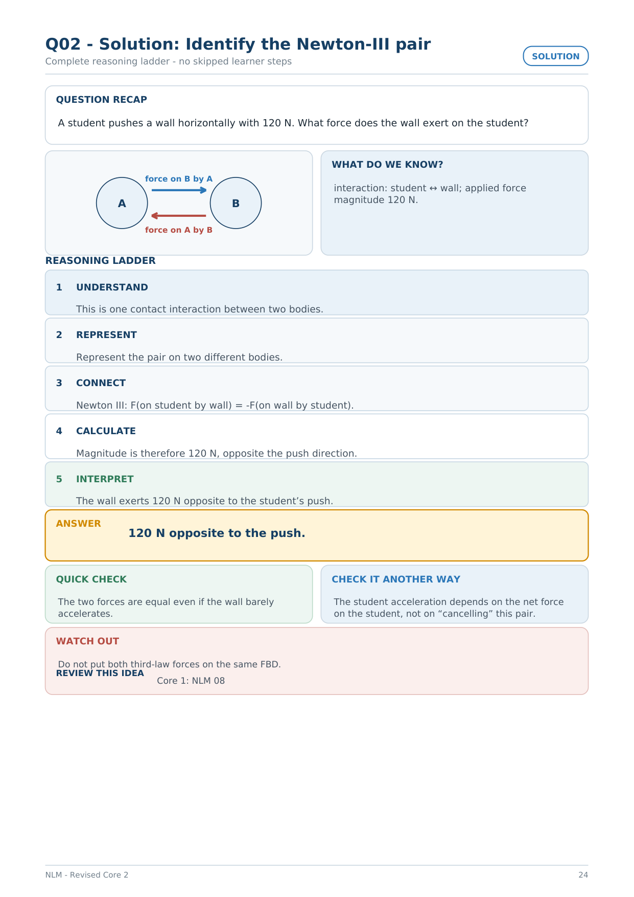
Diagram: Two circles labeled A and B with opposing arrows labeled force on B by A and force on A by B.

<!-- page 25 -->
Q03 - Solution: Catching time and average force
Complete reasoning ladder - no skipped learner steps
SOLUTION
QUESTION RECAP
A 0.40 kg ball moving at 15 m/s is brought to rest. Compare the average force magnitude if it is stopped
in 0.10 s versus 0.30 s.
same Δp, different stopping time
short Δt → large |Favg|
long Δt → smaller |Favg|
WHAT DO WE KNOW?
m=0.40 kg; vᵢ=15 m/s; v_f=0; Δt=0.10 s or 0.30 s.
REASONING LADDER
1
UNDERSTAND
Same Δp in both catches; only Δt differs.
2
REPRESENT
Take motion as positive: pᵢ=0.40(15)=6 kg·m/s and p_f=0.
3
CONNECT
Use F_avg=Δp/Δt with Δp=-6 kg·m/s.
4
CALCULATE
|F|=6/0.10=60 N; second case |F|=6/0.30=20 N.
5
INTERPRET
Tripling stopping time reduces average force magnitude to one-third.
ANSWER
60 N versus 20 N; the 0.30 s catch has one-third the force.
QUICK CHECK
60×0.10 = 20×0.30 = 6 N·s, the same impulse
magnitude.
CHECK IT ANOTHER WAY
A longer stopping time with the same impulse must
lower average force.
WATCH OUT
Do not compare force using speed alone; compare Δp and Δt.
REVIEW THIS IDEA
Core 1: NLM 06-07
NLM - Revised Core 2
25
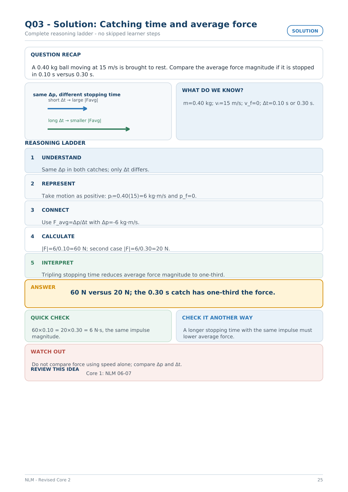
Diagram: Two rightward arrows: a shorter arrow labeled short Δt → large |Favg| and a longer arrow labeled long Δt → smaller |Favg|.

<!-- page 26 -->
Q04 - Solution: Inertia during sudden braking
Complete reasoning ladder - no skipped learner steps
SOLUTION
QUESTION RECAP
A standing passenger in a bus lurches forward when the bus brakes suddenly. Explain the effect without
inventing a forward force of inertia.
vehicle acceleration ←
passenger tends to continue →
WHAT DO WE KNOW?
bus initially moving; bus acceleration becomes
backward during braking.
REASONING LADDER
1
UNDERSTAND
The passenger initially shares the bus forward velocity.
2
REPRESENT
Represent the bus as slowing beneath the passenger; avoid a fictitious forward force in an
inertial-frame FBD.
3
CONNECT
Newton I explains persistence of velocity until external forces change it.
4
CALCULATE
Feet are decelerated by contact; the upper body continues forward briefly, producing the lurch.
5
INTERPRET
The forward lurch is an inertia effect, not evidence of a new forward force.
ANSWER
Passenger lurches forward because the body tends to retain its
pre-braking forward velocity.
QUICK CHECK
If the bus braked gently over a longer time, the lurch
would be smaller.
CHECK IT ANOTHER WAY
The actual contact force during braking is backward
on the passenger, not forward.
WATCH OUT
Do not add a “force of inertia” to an ordinary inertial-frame FBD.
REVIEW THIS IDEA
Core 1: NLM 01-02
NLM - Revised Core 2
26
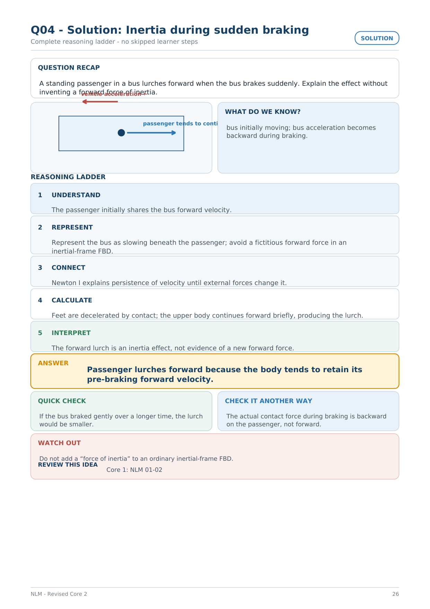
Diagram: A leftward arrow labeled vehicle acceleration ← and a rightward arrow labeled passenger tends to continue →.

<!-- page 27 -->
Q05 - Solution: Coin tossed in an accelerating train
Complete reasoning ladder - no skipped learner steps
SOLUTION
QUESTION RECAP
Inside a train accelerating forward, a passenger tosses a coin vertically. Relative to the passenger, where
does the coin tend to land?
train accelerates →
Airborne coin keeps its prior horizontal velocity while train gains speed.
WHAT DO WE KNOW?
train accelerates forward; coin released with train’s
instantaneous horizontal velocity.
REASONING LADDER
1
UNDERSTAND
At release, coin and train share horizontal velocity; after release only the train continues accelerating
forward.
2
REPRESENT
Compare their horizontal positions over the same airborne time.
3
CONNECT
Train displacement grows faster because of its additional +½at² term.
4
CALCULATE
Thus the passenger/train moves ahead of the coin horizontally.
5
INTERPRET
The coin lands behind the passenger (relative to the accelerating train).
ANSWER
Behind the passenger.
QUICK CHECK
If train acceleration were zero, the coin would return
to the thrower horizontally.
CHECK IT ANOTHER WAY
The coin does not “lose” forward velocity; the train
gains additional forward velocity.
WATCH OUT
Do not treat the coin as if it remains rigidly attached to the accelerating train.
REVIEW THIS IDEA
Core 1: NLM 01-02
NLM - Revised Core 2
27
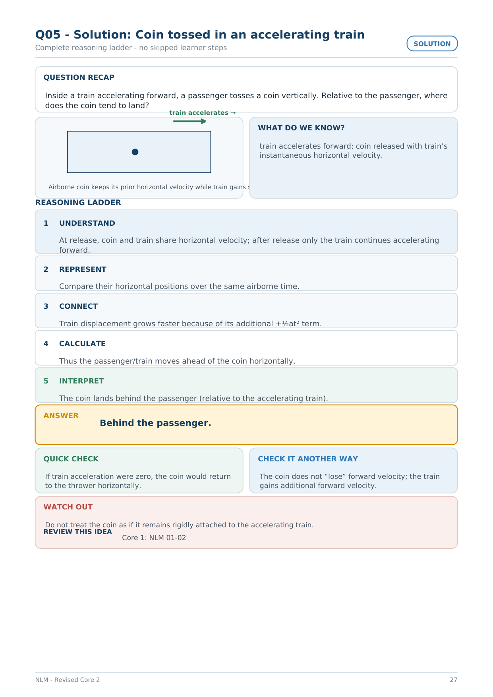
Diagram: A rightward arrow labeled train accelerates → above a box with a dot, captioned Airborne coin keeps its prior horizontal velocity.

<!-- page 28 -->
Q06 - Solution: Constant velocity on a frictionless table
Complete reasoning ladder - no skipped learner steps
SOLUTION
QUESTION RECAP
A puck slides at constant velocity on a perfectly frictionless horizontal table. What horizontal force is
needed to keep it moving?
constant v
N
mg
No horizontal force arrow is needed on the ideal frictionless puck.
WHAT DO WE KNOW?
constant horizontal velocity; ideal frictionless
surface.
REASONING LADDER
1
UNDERSTAND
Constant velocity means zero acceleration.
2
REPRESENT
The vertical forces can balance; horizontally no force is required.
3
CONNECT
ΣFₓ=maₓ=0.
4
CALCULATE
Therefore required horizontal net force is 0 N.
5
INTERPRET
Motion persists without a sustaining horizontal force.
ANSWER
0 N.
QUICK CHECK
A nonzero horizontal force would change the
velocity, contradicting the condition.
CHECK IT ANOTHER WAY
The table still exerts a vertical normal force; “zero
horizontal force” is not “no forces at all”.
WATCH OUT
Do not confuse moving with accelerating.
REVIEW THIS IDEA
Core 1: NLM 01-03
NLM - Revised Core 2
28
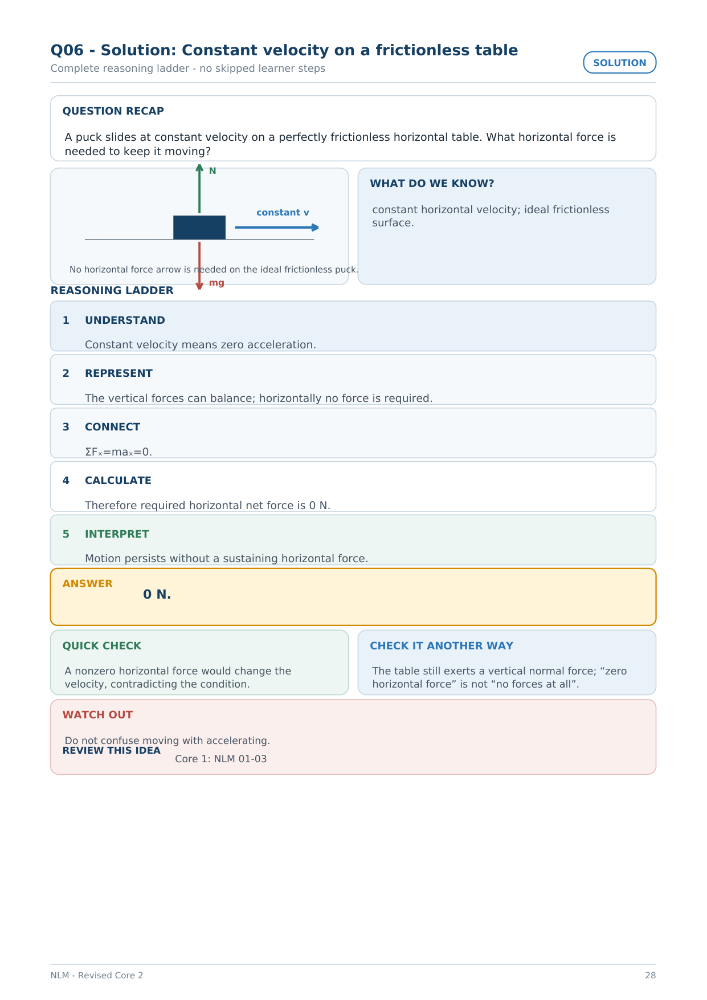
Diagram: A block on a horizontal line with an upward arrow N, a downward arrow mg, and a rightward arrow labeled constant v.

<!-- page 29 -->
Q07 - Solution: Rocket propulsion and momentum
Complete reasoning ladder - no skipped learner steps
SOLUTION
QUESTION RECAP
A rocket ejects exhaust backward in deep space. Explain why the rocket accelerates forward.
rocket
exhaust
WHAT DO WE KNOW?
system: rocket + expelled exhaust; external
impulse neglected over a short interval.
REASONING LADDER
1
UNDERSTAND
Exhaust is accelerated backward; the rocket receives equal-and-opposite interaction forces and
momentum change.
2
REPRESENT
Use a system boundary around rocket plus exhaust and choose forward positive.
3
CONNECT
Conserve total momentum for the simplified short interval.
4
CALCULATE
Backward exhaust momentum is negative; rocket momentum becomes positive to keep total
momentum unchanged.
5
INTERPRET
The rocket accelerates forward while exhaust carries backward momentum.
ANSWER
Forward rocket momentum balances backward exhaust momentum in
the simplified system.
QUICK CHECK
Newton III gives equal/opposite interaction forces;
momentum conservation gives the corresponding
opposite momentum changes.
CHECK IT ANOTHER WAY
The rocket does not need air to “push against”.
WATCH OUT
Do not explain rocket propulsion as exhaust pushing on external air.
REVIEW THIS IDEA
Core 1: NLM 08-10
NLM - Revised Core 2
29
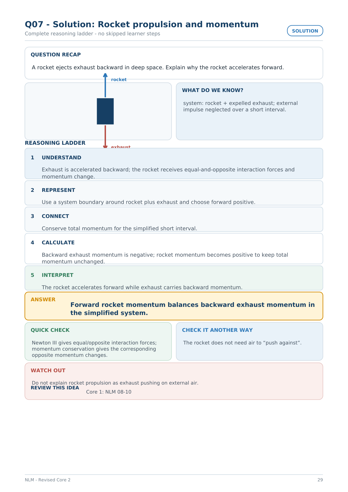
Diagram: A rectangular body with an upward arrow labeled rocket and a downward arrow labeled exhaust.

<!-- page 30 -->
Q08 - Solution: Water tanker braking and inertia
Complete reasoning ladder - no skipped learner steps
SOLUTION
QUESTION RECAP
A partly filled tanker brakes suddenly. Why does the water surge toward the front?
vehicle acceleration ←
water tends to continue →
WHAT DO WE KNOW?
tanker initially moving forward; tanker acceleration
becomes backward.
REASONING LADDER
1
UNDERSTAND
Water has forward momentum before braking.
2
REPRESENT
Compare the braking tank wall with water that initially continues forward relative to the road.
3
CONNECT
Newton I explains the persistence of the water’s forward motion.
4
CALCULATE
Relative to the decelerating tank, the water shifts/surges toward the front.
5
INTERPRET
The surge is an inertia effect caused by different rates of velocity change.
ANSWER
Water surges toward the front.
QUICK CHECK
Gentler braking over more time reduces the relative
surge.
CHECK IT ANOTHER WAY
No forward “inertia force” is needed in a road-frame
explanation.
WATCH OUT
Do not confuse relative motion in the tanker with an extra fundamental force.
REVIEW THIS IDEA
Core 1: NLM 01
NLM - Revised Core 2
30
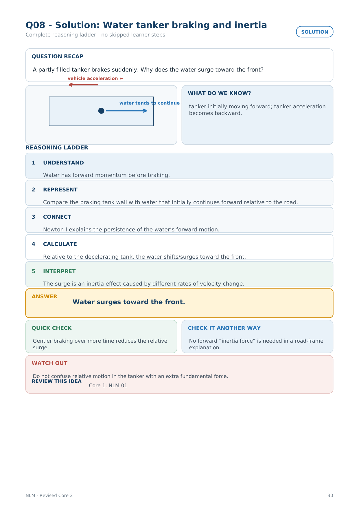
Diagram: A leftward arrow labeled vehicle acceleration ← above a box with a dot and a rightward arrow labeled water tends to continue →.

<!-- page 31 -->
Q09 - Solution: Mass as a measure of inertia
Complete reasoning ladder - no skipped learner steps
SOLUTION
QUESTION RECAP
Three blocks have the same shape but masses 1 kg, 3 kg and 5 kg. Rank their inertia.
1 kg
3 kg
5 kg
larger mass → greater translational inertia
WHAT DO WE KNOW?
masses: 1 kg, 3 kg, 5 kg.
REASONING LADDER
1
UNDERSTAND
Inertia in translational motion scales with mass.
2
REPRESENT
No FBD is needed for a pure ranking; compare masses directly.
3
CONNECT
Larger mass means greater resistance to the same acceleration change.
4
CALCULATE
Therefore inertia: 5 kg > 3 kg > 1 kg.
5
INTERPRET
The 5 kg block has the greatest inertia.
ANSWER
5 kg > 3 kg > 1 kg.
QUICK CHECK
Under the same net force, their accelerations would
rank in the reverse order.
CHECK IT ANOTHER WAY
Inertia is not density or size by itself.
WATCH OUT
Do not rank inertia from volume when mass is given.
REVIEW THIS IDEA
Core 1: NLM 01, NLM 04
NLM - Revised Core 2
31
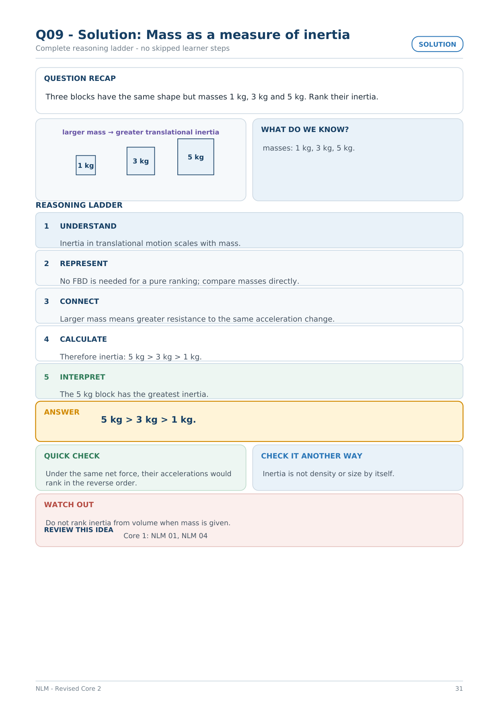
Diagram: Three square boxes labeled 1 kg, 3 kg, and 5 kg in increasing size below a label larger mass → greater translational inertia.

<!-- page 32 -->
Q10 - Solution: Ambiguous rolling claim on a smooth train floor
Complete reasoning ladder - no skipped learner steps
SOLUTION
QUESTION RECAP
A source question places balls on a “smooth” train floor during braking and asks about rolling. Under the
literal ideal-frictionless interpretation, what can and cannot be concluded?
train brakes ←
Ideal smooth floor: vertical N and mg only; no horizontal frictional torque.
WHAT DO WE KNOW?
literal model: ideal smooth/frictionless floor during
train braking.
REASONING LADDER
1
UNDERSTAND
With no horizontal friction, the ball has no horizontal contact force and no frictional torque.
2
REPRESENT
One-ball FBD: N upward, mg downward, no horizontal friction.
3
CONNECT
Thus horizontal acceleration is zero in the ground frame; rolling cannot be inferred from the stated
contact model.
4
CALCULATE
The train slows beneath the ball, so relative translational motion can occur; rolling requires additional
contact physics not specified.
5
INTERPRET
Literal conclusion: relative sliding/translation is explainable; rolling is under-specified.
ANSWER
Rolling is not justified by the literal smooth-floor model; the inertia
comparison is the usable idea.
QUICK CHECK
Adding a specified friction force would change the
rotational conclusion.
CHECK IT ANOTHER WAY
This is a source-quality ambiguity, not a license to
invent a torque.
WATCH OUT
Do not silently “repair” ambiguous source wording into a new scored law statement.
REVIEW THIS IDEA
Core 1: NLM 01-03
NLM - Revised Core 2
32
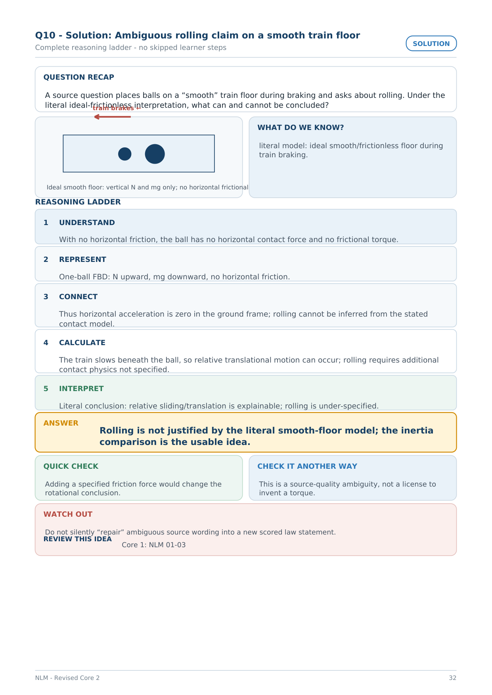
Diagram: A leftward arrow labeled train brakes ← above a box containing two circular balls of different sizes on a smooth floor.

<!-- page 33 -->
Q11 - Solution: Light and heavy rifle recoil
Complete reasoning ladder - no skipped learner steps
SOLUTION
QUESTION RECAP
Two rifles fire bullets with the same forward momentum. One rifle has half the mass of the other.
Compare their recoil momenta and recoil speeds.
bullet +p
rifle -p
WHAT DO WE KNOW?
same bullet momentum; rifle masses M and 2M.
REASONING LADDER
1
UNDERSTAND
Each rifle receives the same recoil momentum magnitude opposite its bullet.
2
REPRESENT
Use p_rifle=-p_bullet and v=p/M.
3
CONNECT
v_light=|p|/M; v_heavy=|p|/(2M).
4
CALCULATE
Therefore v_light=2v_heavy while the recoil momenta are equal in magnitude.
5
INTERPRET
Lighter rifle recoils twice as fast; recoil momentum magnitudes are equal.
ANSWER
Equal recoil momentum; lighter rifle has twice the recoil speed.
QUICK CHECK
M_light v_light = M_heavy v_heavy = |p|.
CHECK IT ANOTHER WAY
A larger recoil speed does not mean larger recoil
momentum here.
WATCH OUT
Do not confuse equal momentum with equal velocity.
REVIEW THIS IDEA
Core 1: NLM 09-10
NLM - Revised Core 2
33
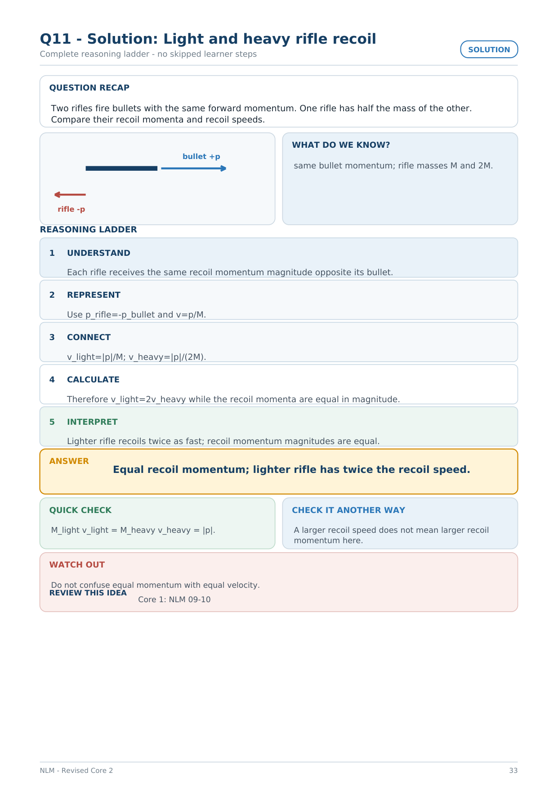
Diagram: A horizontal bar with a rightward arrow labeled bullet +p and a shorter leftward arrow labeled rifle -p.

<!-- page 34 -->
Q12 - Solution: Horse and cart at constant speed
Complete reasoning ladder - no skipped learner steps
SOLUTION
QUESTION RECAP
A horse pulls a cart at constant speed on a level road. The horse pulls forward on the cart with 500 N.
What must the total backward resistance on the cart be?
cart
500 N
R
WHAT DO WE KNOW?
cart: constant speed; horse-on-cart = 500 N
forward.
REASONING LADDER
1
UNDERSTAND
Constant speed in a straight line means a=0.
2
REPRESENT
Cart FBD only; do not add cart-on-horse to the cart FBD.
3
CONNECT
Newton II gives ΣFₓ=0.
4
CALCULATE
500-R=0, so R=500 N backward.
5
INTERPRET
The resistance balances the horse’s forward pull on the cart.
ANSWER
500 N backward.
QUICK CHECK
Any other resistance would make the cart
accelerate, contradicting constant speed.
CHECK IT ANOTHER WAY
The horse-cart third-law pair is not the same as the
balanced forces on the cart.
WATCH OUT
Do not cancel forces that act on different bodies.
REVIEW THIS IDEA
Core 1: NLM 01-03, NLM 08
NLM - Revised Core 2
34
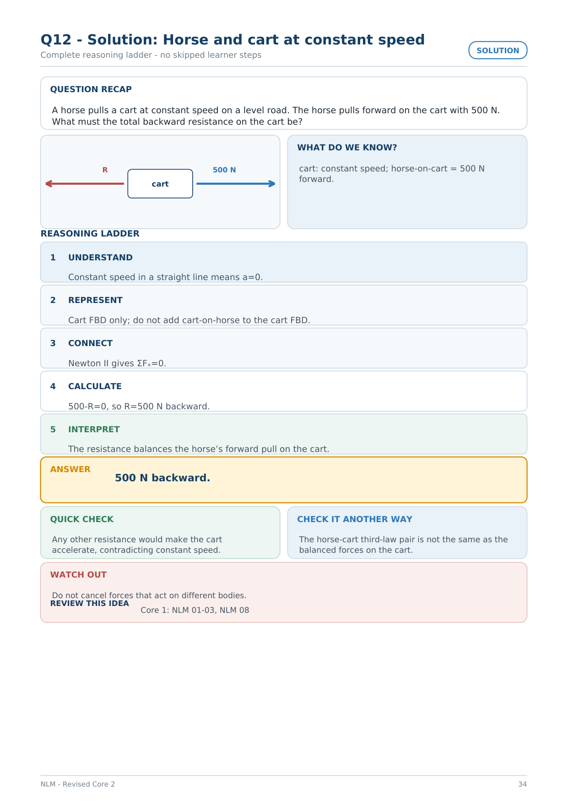
Diagram: A central box labeled cart with a leftward arrow labeled R and a rightward arrow labeled 500 N.

<!-- page 35 -->
Q13 - Solution: Why a falling ball alone does not conserve momentum
Complete reasoning ladder - no skipped learner steps
SOLUTION
QUESTION RECAP
A ball falls freely and its downward momentum increases. Can you say the ball’s momentum is
conserved because the initial and final momentum happen to have some matching magnitude in two
observations?
gravity crosses boundary
ball-only system
WHAT DO WE KNOW?
system: ball only; gravity acts throughout fall.
REASONING LADDER
1
UNDERSTAND
Gravity changes the ball momentum continuously.
2
REPRESENT
Ball-only boundary has external gravitational force.
3
CONNECT
Momentum conservation for the ball alone is not valid over the fall interval.
4
CALCULATE
Any equality of selected momentum magnitudes would be coincidental, not a conservation proof.
5
INTERPRET
Ball-only momentum is not conserved during free fall.
ANSWER
No; gravity gives external impulse to the ball-only system.
QUICK CHECK
Including Earth + ball can move the gravitational
interaction inside the system boundary.
CHECK IT ANOTHER WAY
Conservation is about the system and external
impulse, not just matching numbers.
WATCH OUT
Do not infer conservation from one object’s before/after momentum values.
REVIEW THIS IDEA
Core 1: NLM 09
NLM - Revised Core 2
35
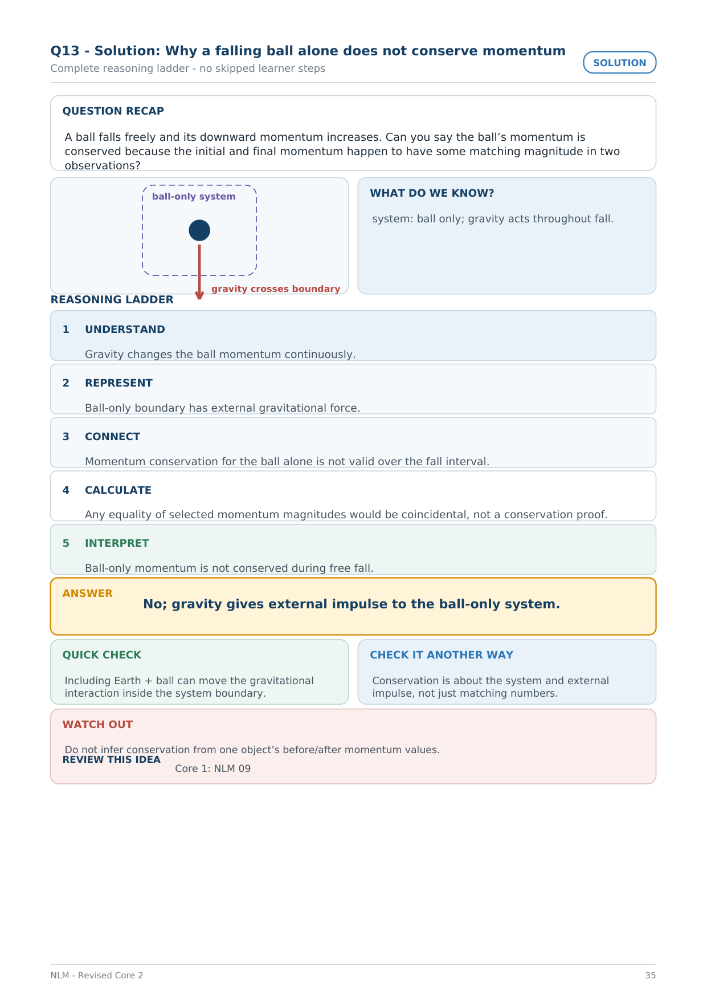
Diagram: A dashed boundary labeled ball-only system containing a circular ball with a downward arrow labeled gravity crosses boundary.

<!-- page 36 -->
Q14 - Solution: Friction from a velocity-time graph
Complete reasoning ladder - no skipped learner steps
SOLUTION
QUESTION RECAP
A 50 g slider slows uniformly from 80 m/s to rest in 8 s. If friction is the only horizontal force, find the
friction force.
t
v
80
8 s
slope = acceleration → friction force if friction is the only horizontal force
WHAT DO WE KNOW?
m=0.050 kg; v changes 80→0 m/s over 8 s.
REASONING LADDER
1
UNDERSTAND
Uniform slowing means constant negative acceleration.
2
REPRESENT
Read a from the v-t slope.
3
CONNECT
a=(0-80)/8=-10 m/s².
4
CALCULATE
F=ma=0.050(-10)=-0.50 N.
5
INTERPRET
Negative sign means friction opposes the positive motion.
ANSWER
0.50 N opposite the motion.
QUICK CHECK
Impulse magnitude 0.50×8=4 N·s equals
|Δp|=0.050×80=4 kg·m/s.
CHECK IT ANOTHER WAY
Graph area is displacement, not acceleration.
WATCH OUT
Do not use the area under v-t when the requested bridge is slope → acceleration → force.
REVIEW THIS IDEA
Core 1: NLM 11
NLM - Revised Core 2
36
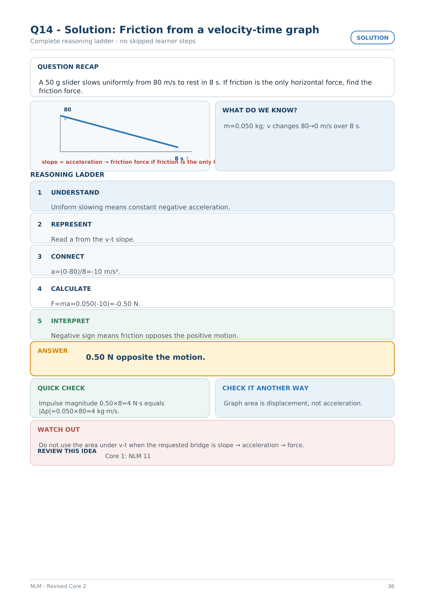
Diagram: A velocity-time graph showing a line descending from 80 on the vertical axis to 8 s on the horizontal axis.

<!-- page 37 -->
Q15 - Solution: Force-mass scaling
Complete reasoning ladder - no skipped learner steps
SOLUTION
QUESTION RECAP
An object accelerates at a under net force F and mass m. The force becomes F/2 while the mass
becomes 2m. What is the new acceleration?
state
Fnet
mass
acceleration
old
F
m
a
new
F/2
2m
?
WHAT DO WE KNOW?
initial: F,m,a; new: F/2,2m.
REASONING LADDER
1
UNDERSTAND
Acceleration depends on both net force and mass.
2
REPRESENT
Use symbolic old/new states.
3
CONNECT
a₂=(F/2)/(2m)=F/(4m).
4
CALCULATE
Since a₁=F/m, a₂=a₁/4.
5
INTERPRET
The acceleration becomes one quarter of the original.
ANSWER
a/4.
QUICK CHECK
If only the force halved, it would be a/2; the mass
change halves it once more.
CHECK IT ANOTHER WAY
Direct substitution gives (F/2)/(2m)=F/(4m),
confirming one-quarter of F/m.
WATCH OUT
Do not change only one factor when both force and mass change.
REVIEW THIS IDEA
Core 1: NLM 04
NLM - Revised Core 2
37
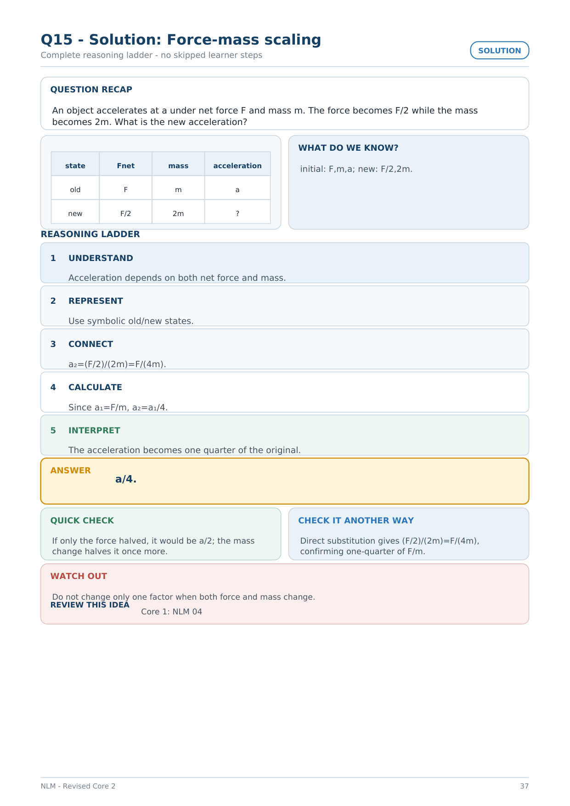
Diagram: A table with columns state, Fnet, mass, acceleration listing rows old: F, m, a and new: F/2, 2m, ?.

<!-- page 38 -->
Q16 - Solution: Skaters push apart
Complete reasoning ladder - no skipped learner steps
SOLUTION
QUESTION RECAP
Two skaters of masses 50 kg and 75 kg push apart from rest. The 50 kg skater moves left at 3 m/s. Find
the velocity of the 75 kg skater.
SYSTEM
Check external impulse before conserving total momentum.
WHAT DO WE KNOW?
system: both skaters; p_initial=0; m₁=50 kg, v₁=-3
m/s; m₂=75 kg.
REASONING LADDER
1
UNDERSTAND
Internal push forces exchange equal/opposite momentum; external horizontal impulse is neglected.
2
REPRESENT
Choose right positive and keep signed velocities.
3
CONNECT
0=50(-3)+75v₂.
4
CALCULATE
75v₂=150, so v₂=+2 m/s.
5
INTERPRET
The heavier skater moves more slowly to carry the same opposite momentum magnitude.
ANSWER
2 m/s to the right.
QUICK CHECK
50×3=150 and 75×2=150 kg·m/s, so momenta
cancel.
CHECK IT ANOTHER WAY
Equal interaction forces do not imply equal speeds.
WATCH OUT
Do not drop the sign of the left-moving skater.
REVIEW THIS IDEA
Core 1: NLM 09-10
NLM - Revised Core 2
38
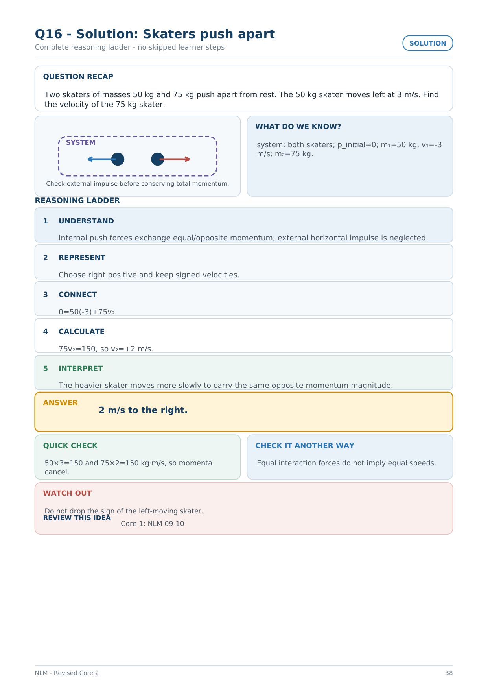
Diagram: A dashed boundary labeled SYSTEM containing two dots with opposing arrows pointing away from each other.

<!-- page 39 -->
Q17 - Solution: Sprinkler reaction
Complete reasoning ladder - no skipped learner steps
SOLUTION
QUESTION RECAP
A sprinkler ejects water tangentially backward from its nozzles. Why does the sprinkler rotate in the
opposite sense?
A
B
force on B by A
force on A by B
WHAT DO WE KNOW?
interaction: sprinkler ↔ expelled water.
REASONING LADDER
1
UNDERSTAND
Water is accelerated one way; the sprinkler receives the reaction force the other way.
2
REPRESENT
Use two-body interaction arrows, not a single-body cancellation.
3
CONNECT
Newton III gives equal magnitude, opposite direction forces on different bodies.
4
CALCULATE
The reaction forces on the arms create a turning effect opposite the water-jet direction.
5
INTERPRET
The sprinkler rotates opposite the ejected-water direction.
ANSWER
Opposite to the water jets.
QUICK CHECK
Reversing nozzle directions reverses the reaction
and rotation sense.
CHECK IT ANOTHER WAY
The water force and sprinkler reaction do not cancel
on one body.
WATCH OUT
Do not call the two arrows “balanced forces” on the sprinkler.
REVIEW THIS IDEA
Core 1: NLM 08
NLM - Revised Core 2
39
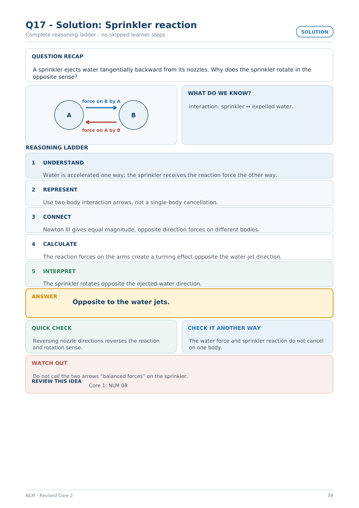
Diagram: Two circles labeled A and B with opposing arrows labeled force on B by A and force on A by B.

<!-- page 40 -->
Q18 - Solution: Bullet stopping force and time
Complete reasoning ladder - no skipped learner steps
SOLUTION
QUESTION RECAP
A 0.020 kg bullet enters a block at 100 m/s and stops uniformly in 0.10 m. Find the average stopping
force and stopping time.
u
stop over s
WHAT DO WE KNOW?
m=0.020 kg; u=100 m/s; v=0; s=0.10 m; uniform
deceleration.
REASONING LADDER
1
UNDERSTAND
First determine the kinematic acceleration, then convert it to force.
2
REPRESENT
Use v²=u²+2as because time is not needed for the first step.
3
CONNECT
0=10000+0.20a → a=-50000 m/s².
4
CALCULATE
F=ma=0.020(-50000)=-1000 N. Then 0=100+(-50000)t → t=0.0020 s.
5
INTERPRET
Force is 1000 N opposite the bullet motion; stopping time is 2.0 ms.
ANSWER
1000 N opposite motion; 0.0020 s.
QUICK CHECK
Impulse: 1000×0.002=2 N·s = mΔv = 0.020×100.
CHECK IT ANOTHER WAY
Using impulse, |F|t=1000(0.002)=2 N·s, matching
m|Δv|=0.020(100)=2 N·s.
WATCH OUT
Do not try to infer force directly from stopping distance without finding acceleration.
REVIEW THIS IDEA
Core 1: NLM 05-07
NLM - Revised Core 2
40

Diagram: A dot with a rightward arrow labeled u pointing toward a rectangular region labeled stop over s.

<!-- page 41 -->
Q19 - Solution: Combined masses under the same force
Complete reasoning ladder - no skipped learner steps
SOLUTION
QUESTION RECAP
A 5 N force gives mass m₁ acceleration 8 m/s² and mass m₂ acceleration 24 m/s². If the masses are tied
together and the same 5 N net force acts, find the acceleration.
case
F
a
m=F/a
1
5 N
8 m/s²
5/8 kg
2
5 N
24 m/s²
5/24 kg
WHAT DO WE KNOW?
F=5 N; a₁=8 m/s²; a₂=24 m/s²; tied system under
same 5 N.
REASONING LADDER
1
UNDERSTAND
Infer individual masses from the same force.
2
REPRESENT
m₁=5/8 kg; m₂=5/24 kg; total mass is their sum.
3
CONNECT
m_total=5/8+5/24=15/24+5/24=20/24=5/6 kg.
4
CALCULATE
a=F/m_total=5/(5/6)=6 m/s².
5
INTERPRET
The tied pair accelerates at 6 m/s².
ANSWER
6 m/s².
QUICK CHECK
The result is below both individual accelerations
because the combined mass exceeds either mass.
CHECK IT ANOTHER WAY
1 N = 1 kg·m/s²; keep SI units consistent.
WATCH OUT
Do not average the two accelerations; add masses, then use F/m_total.
REVIEW THIS IDEA
Core 1: NLM 04
NLM - Revised Core 2
41
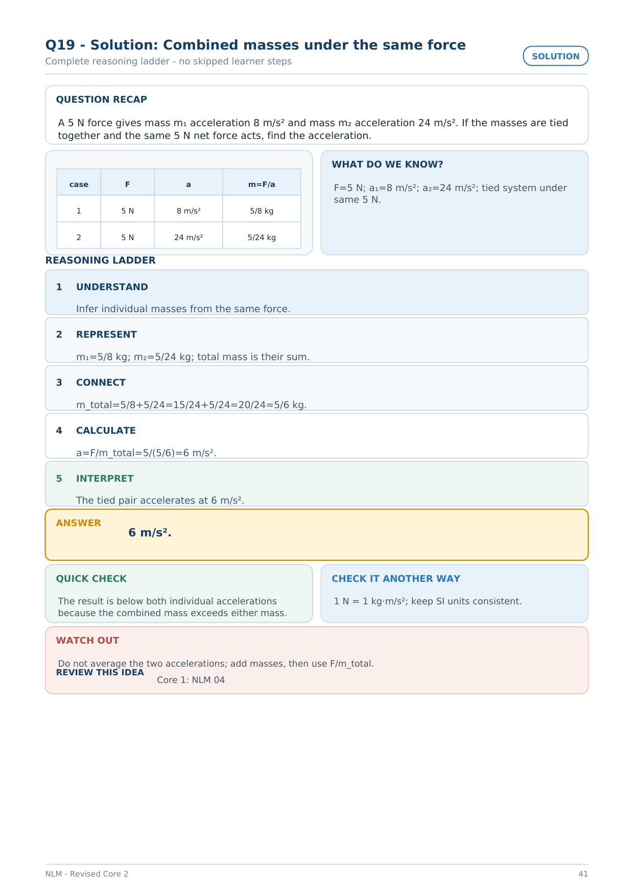
Diagram: A table comparing cases 1 and 2 with columns F, a, and m=F/a listing values 5 N, 8 m/s², and 24 m/s².

<!-- page 42 -->
Q20 - Solution: Momentum graphs and force as rate of change
Complete reasoning ladder - no skipped learner steps
SOLUTION
QUESTION RECAP
For p=mv, what do the slopes of a p-v graph at fixed mass and a p-m graph at fixed velocity represent?
How is force related to momentum change?
p vs v
slope = mass
p vs m
slope = velocity
WHAT DO WE KNOW?
relation p=mv; compare p-v and p-m graphs; force
from momentum rate.
REASONING LADDER
1
UNDERSTAND
Both graphs are linear through the origin when the held quantity is constant.
2
REPRESENT
p-v: slope m. p-m: slope v.
3
CONNECT
Force measures the time rate of momentum change.
4
CALCULATE
Thus slope(p-v)=m, slope(p-m)=v, and F_avg=Δp/Δt.
5
INTERPRET
The graph slopes have direct physical meaning and force is not itself momentum.
ANSWER
slope(p-v)=m; slope(p-m)=v; F_avg=Δp/Δt.
QUICK CHECK
Units: (kg·m/s)/(m/s)=kg for the p-v slope;
(kg·m/s)/kg=m/s for the p-m slope.
CHECK IT ANOTHER WAY
Dimensional check: slope(p-v) has units kg;
slope(p-m) has units m/s.
WATCH OUT
Do not read graph height as the slope or confuse momentum with force.
REVIEW THIS IDEA
Core 1: NLM 06-07
NLM - Revised Core 2
42
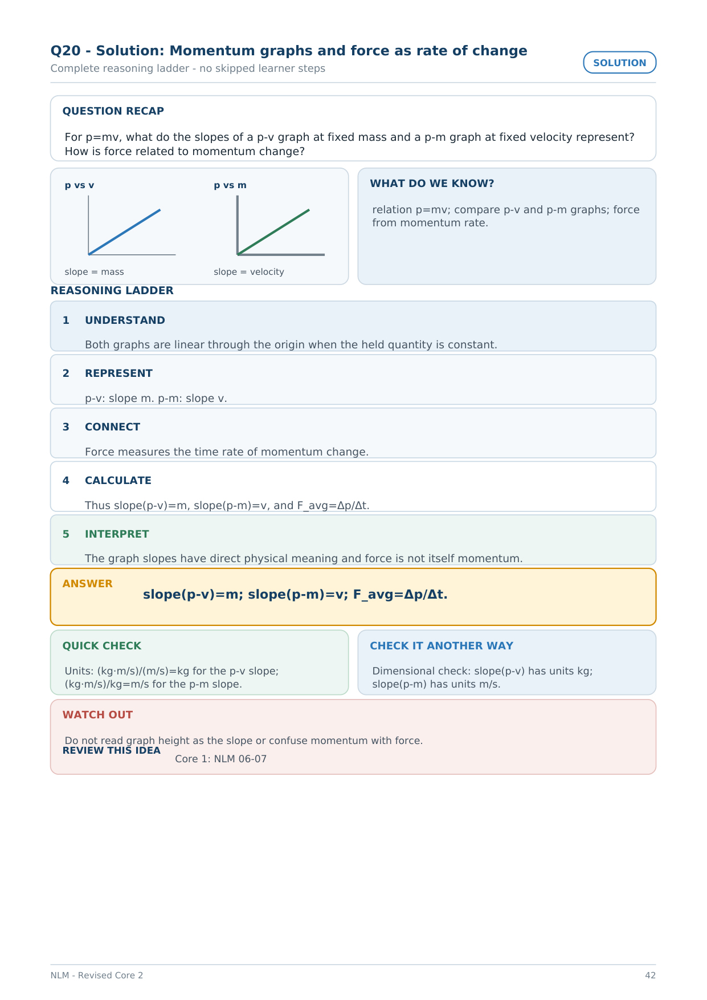
Diagram: Two linear graphs: left graph labeled p vs v with slope = mass; right graph labeled p vs m with slope = velocity.
