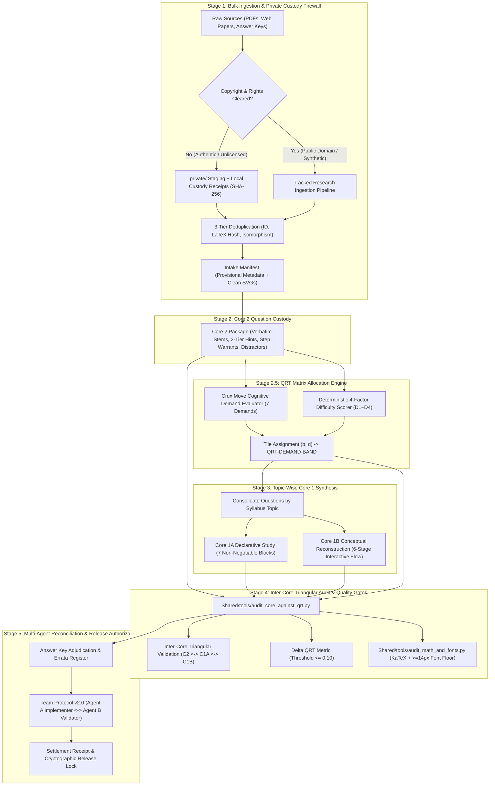

# CONCEPT NOTE: End-to-End Curriculum Pipeline Architecture
## From Bulk Intake to Core 2 Custody, QRT Matrix Allocation, Core 1 Synthesis, and Golden Fixture Reconciliation

**Version:** 2.1.0  
**Status:** Certified Architectural Standard  
**Subject:** Grade 9 International Mathematics Olympiad (IMO) Curriculum Suite  
**Audience:** Curriculum Engineers, Autonomous Agents, and Quality Assurance Specialists  
**Governing Specifications:**
- `BP-CORE2-CUSTODY@1.1.0` (Question Custody, Distractor Diagnosis & Private Firewall)
- `BP-CORE1A-CONSTRUCTION@1.9.0` (Declarative Study — 7 Non-Negotiable Blocks & Anti-Spoil Law)
- `BP-CORE1B-RECONSTRUCTION@1.2.0` (Self-Tutor Dialogue — 6-Stage Elicitation & Model Alternation)
- `QRT-MATRIX-GOVERNANCE@2.1.0` (28-Cell Cognitive Demand Matrix: 4 Bands $\times$ 7 Demands)
- `TEAM-PROTOCOL@2.0.0` (Multi-Agent Role Separation: Implementer, Validator, Owner Coordinator)

---

## 1. Executive Summary & Architectural Foundation

### The Cognitive Drift Challenge in Autonomous Multi-Agent Pipelines
In large-scale Olympiad curriculum engineering across autonomous agents, cognitive drift, schema regression, and unverified promotions occur primarily due to five distinct failure modes:
1. **Premature Generation:** Instructional units (Core 1A/1B) are authored before the entire question corpus is consolidated and custody is certified.
2. **Missing Transition Engine:** Questions transition directly from raw intake to generic topics without a formal, deterministic **QRT Assignment Task** based on crux cognitive moves and 4-factor difficulty scoring.
3. **Private Source Leakage (The Copyright Gap):** Authentic competition papers and copyrighted figures are committed directly into public repositories or Actions artifacts instead of being isolated behind a **Private Source Custody Firewall**.
4. **Golden Fixture Disconnect & Self-Grading:** Agents author content and simultaneously evaluate their own outputs, leading to false-positive test passes, silent schema widening, and drift from frozen reference goldens (`DemandReview.json`, `G-CORE2-R2`).
5. **Tooling & Environment Desynchronization:** Scripts run with undeclared third-party dependencies (`jsonschema`, `pypdf`) or platform-specific path assumptions (POSIX `/` vs Windows `\`), causing fresh GitHub Actions runner checkouts to fail closed.

### The Architectural Remedy: Strict 5-Stage Unidirectional Pipeline
This standard establishes a **strict 5-stage unidirectional pipeline** governed by fail-closed boundaries where no stage may proceed without a certified, cryptographic handoff from its predecessor:

$$\text{Stage 1: Bulk Intake} \longrightarrow \text{Stage 2: Core 2 Custody} \longrightarrow \mathbf{Stage\;2.5:\;QRT\;Assignment} \longrightarrow \text{Stage 3: Core 1A/1B} \longrightarrow \text{Stage 4: Audit} \longrightarrow \text{Stage 5: Reconcile}$$



---

## 2. Stage-by-Stage Specifications & Schemas

### Stage 1: Bulk Intake, 3-Tier Deduplication & The Private Custody Firewall

#### A. The Private Source Custody Firewall (Issue #183 / Q003 Standard)
Raw competition exam papers (such as SOF IMO, AMC 10/12, or Regional Olympiads) frequently contain copyrighted examination text, figures, and proprietary layouts. To prevent irreversible intellectual property contamination of the public repository:
1. **Zero-Byte Public Footprint:** Raw competition PDFs, verbatim copyrighted question banks, and complete learner HTML rendered from unreleased papers must **never** be checked into tracked git trees, committed to public PRs, or uploaded to public CI Actions artifacts.
2. **Local Sandbox Staging:** Authentic examination inputs reside strictly within `.private/` (enforced via `.gitignore`) or external private storage.
3. **Cryptographic Proof Custody:** The repository tracks only tamper-evident cryptographic receipts containing:
   - Source document SHA-256 fingerprint.
   - Exact printed page number and question index.
   - Canonical question identifier (`SOF-IMO-G09-L1-YYYY-YY-S-QXXX`).
   - Verified normalized component hash (`source_item_sha256`).

#### B. 3-Tier Deduplication Protocol
1. **Level 1 (ID & Locator Parity):** Verify `[Year, Set, Question Number]`. If already present in baseline, record as verbatim identity match.
2. **Level 2 (Normalized LaTeX Hash):** Strip whitespace, normalize variable identifiers (e.g. $x \to \theta$), sort commutative sums, replace raw `%` with `\%`, and compute SHA-256 hash of the equation string. Detects identical stems renumbered across different papers.
3. **Level 3 (Structural Isomorphism):** Identify questions that share the exact geometric figure topology or algebraic constraint equation with merely scaled numerical constants.

#### Ingestion Schema (`imo-bulk-intake-batch/v1`):
```json
{
  "$schema": "https://json-schema.org/draft/2020-12/schema",
  "title": "BulkQuestionIntakeBatch",
  "type": "object",
  "required": ["batch_id", "source_metadata", "items"],
  "properties": {
    "batch_id": { "type": "string", "pattern": "^BATCH-[0-9]{2}-SOF-IMO-[0-9]{4}-[0-9]{2}-[A-B]$" },
    "source_metadata": {
      "type": "object",
      "required": ["origin_url", "local_cached_path", "sha256", "rights_clearance"],
      "properties": {
        "origin_url": { "type": "string", "format": "uri" },
        "local_cached_path": { "type": "string" },
        "sha256": { "type": "string", "pattern": "^[a-f0-9]{64}$" },
        "rights_clearance": { "type": "string", "enum": ["PUBLIC_DOMAIN", "LICENSED", "PRIVATE_DEVELOPMENT_ONLY"] }
      }
    },
    "items": {
      "type": "array",
      "items": {
        "type": "object",
        "required": [
          "raw_index", "canonical_id", "verbatim_stem", "options",
          "official_key", "dedup_verification", "svg_asset_path"
        ],
        "properties": {
          "raw_index": { "type": "integer", "minimum": 1, "maximum": 50 },
          "canonical_id": { "type": "string", "pattern": "^SOF-IMO-G09-L1-[0-9]{4}-[0-9]{2}-[A-B]-Q[0-9]{3}$" },
          "verbatim_stem": { "type": "string" },
          "options": {
            "type": "object",
            "required": ["A", "B", "C", "D"],
            "properties": { "A": { "type": "string" }, "B": { "type": "string" }, "C": { "type": "string" }, "D": { "type": "string" } }
          },
          "official_key": { "type": "string", "enum": ["A", "B", "C", "D"] },
          "svg_asset_path": { "type": ["string", "null"] },
          "dedup_verification": {
            "type": "object",
            "required": ["latex_hash", "isomorphism_checked", "is_duplicate"],
            "properties": {
              "latex_hash": { "type": "string" },
              "isomorphism_checked": { "type": "boolean" },
              "is_duplicate": { "type": "boolean" },
              "duplicate_of": { "type": ["string", "null"] }
            }
          }
        }
      }
    }
  }
}
```

---

### Stage 2: Core 2 Question Custody (`BP-CORE2-CUSTODY@1.1.0`)

Core 2 preserves the pristine integrity of the source exam item while augmenting it with cognitive scaffolds, formal warrants, and distractor rationales.

#### Non-Negotiable Core 2 Elements:
1. **Verbatim Question Stem & Options:** Preserves original exam phrasing and notation without silent rewriting.
2. **Two-Tier Progressive Hint Ladder (Fail-Closed Delivery):**
   - **Hint 1 (`ACTIVATE_INVARIANT`):** Re-activates the dormant theorem, symmetry, or invariant without doing the algebra or spoiling the answer.
   - **Hint 2 (`DECISIVE_INTERMEDIATE_FORMULATION`):** Supplies the critical intermediate equation, coordinate setup, or auxiliary construction.
   - Both rungs must be enclosed in structural container wrappers (`<div class="ladder-rung">` and `<span class="rung-tag">`) and remain locked until learner attempt commitment.
3. **Step-by-Step Derivation with Mathematical Warrants:** Every intermediate equation must include an explicit `why_valid` justification.
4. **Distractor Rationales:** Formulates the specific cognitive trap leading to each incorrect answer choice ($A, B, C, D$).
5. **Formal Verification Check:** Concrete verification type (`SUBSTITUTION_BACK_CHECK`, `DOMAIN_CHECK`, `LIMITING_CASE`, `ALTERNATE_METHOD`).
6. **Vector SVG Visual Standards:** Inline or referenced SVGs must satisfy the strict typography floor ($\text{font-size} \ge 14\text{px}$) across all viewport widths ($320\text{px} - 1280\text{px}$).

---

### Stage 2.5: The Core 2 $\longrightarrow$ QRT Matrix Assignment Engine

This engine bridges raw Core 2 question custody into the **28-cell Question Review Template (QRT) matrix** ($4\text{ Bands } D1–D4 \times 7\text{ Demands } 1–7$).

#### A. Crux Cognitive Demand Determination (The 7 Canonical Demands)
The demand is selected based on the **decisive crux cognitive move** required to break the problem open:

| Demand Coordinate $d$ | Canonical Token | Cognitive Move Definition | Operational Indicator |
| :---: | :--- | :--- | :--- |
| **$d = 1$** | `RETRIEVE` | Recalling theorems, definitions, or domain restrictions. | Directly querying theorem hypotheses or definitions without multi-step algebra. |
| **$d = 2$** | `EXPLAIN` | Articulating why a pattern, invariant, or geometric property holds. | Structural rationale of equivalence; symbolic substitution alone does not qualify. |
| **$d = 3$** | `APPLY` | Direct algorithmic execution of known formulas preserving domain bounds. | Standard formula substitution, polynomial division, or coordinate computation. |
| **$d = 4$** | `MODEL` | Formulating mathematical relations from unstructured physical contexts; evaluating competing models. | Setting up systems of equations from word problems, optimizing geometric configurations, or selecting invariant models. |
| **$d = 5$** | `REPRESENT` | Translating bidirectionally across visual, tabular, and algebraic notation. | Converting geometric sketches to coordinate systems, frequency tables to polynomials, or multi-solid nets. |
| **$d = 6$** | `SYNTHESIZE` | Fusing two or more distinct mathematical syllabus domains. | Combining number theory divisibility with geometric series, or coordinate geometry with quadratic roots. |
| **$d = 7$** | `JUSTIFY` | Constructing rigorous deductive proofs of invariance under perturbation or refuting invalid criteria by counterexample. | Proving why no other solution exists, parity arguments, or extremum uniqueness proofs. |

> [!WARNING]
> Secondary demands must come exclusively from the 7 canonical tokens. Non-canonical tokens like `VERIFY` are strictly forbidden and fail closed.

#### B. Difficulty Band Deterministic Rubric ($D1$–$D4$)
Difficulty is computed from cognitive load points:

$$\text{Points} = S_{\text{steps}} + S_{\text{representations}} + S_{\text{novelty}} + S_{\text{traps}}$$

- **$S_{\text{steps}}$ (Derivation Length):**
  - $1 - 2$ single-formula steps: $+1\text{ pt}$
  - $3 - 4$ multi-phase steps: $+2\text{ pts}$
  - $\ge 5$ chained deduction steps: $+3\text{ pts}$
- **$S_{\text{representations}}$ (Format Translation):**
  - Purely symbolic/algebraic: $+0\text{ pts}$
  - Translating between SVG diagram and algebraic equations: $+2\text{ pts}$
- **$S_{\text{novelty}}$ (Curricular Novelty):**
  - Standard textbook routine: $+0\text{ pts}$
  - Auxiliary line construction / Non-standard orientation: $+2\text{ pts}$
  - IMO Achievers Section / Multi-solid extremum optimization: $+3\text{ pts}$
- **$S_{\text{traps}}$ (Distractor Sophistication):**
  - Simple calculation slip: $+0\text{ pts}$
  - Subtle boundary/sign/collinearity misconception: $+1\text{ pt}$

$$\begin{array}{|c|c|l|}
\hline
\textbf{Total Points} & \textbf{Band Coordinate } b & \textbf{Difficulty Band} \\
\hline
0 - 2 & 1 & \mathbf{D1}\text{ (Foundational / Direct)} \\
3 - 5 & 2 & \mathbf{D2}\text{ (Standard Olympiad / Intermediate)} \\
6 - 7 & 3 & \mathbf{D3}\text{ (Advanced / Composite)} \\
8 - 10 & 4 & \mathbf{D4}\text{ (Mastery / Research-Level)} \\
\hline
\end{array}$$

---

### Stage 3: Topic-Wise Core 1A & Core 1B Synthesis

Once questions in a syllabus topic are locked into Core 2 and assigned their QRT coordinates, instructional packages are synthesized.

#### Core 1A Declarative Study (`BP-CORE1A-CONSTRUCTION@1.9.0`): The 7 Non-Negotiable Blocks
1. **`entry_assumptions`:** Explicit declaration of prerequisite concepts, theorems, and definitions.
2. **`inferential_jump`:** 1–2 sentence statement of the exact cognitive leap a learner cannot make unaided.
3. **`relation_refs`:** Explicit specification of `domain` (e.g. $\mathbb{R}^+$), `hypotheses` (e.g. non-degeneracy), and `excluded_values` (e.g. division by zero).
4. **`representation`:** 3-way mapping table ($\text{Symbol} \longleftrightarrow \text{SVG Element} \longleftrightarrow \text{Word Meaning}$).
5. **`completed_teaching_path`:** Every single deduction step carries an explicit `why_valid` mathematical warrant.
6. **`misconceptions`:** Plausible intuitive fallacy (`wrong_idea`), discriminating probe (`diagnostic_prompt`), and actionable rectification rule (`repair`).
7. **`worked_concept_anchor` & `exit_task`:** Deductive model anchor paired with an independent active recall exit task on a structurally modified problem with a self-verification check.

> [!IMPORTANT]
> **The Anti-Spoil Law (PR 246):** Teaching steps in Core 1A must **never** disclose the minimal parameter set or derivation route of the exit task.
> **The Model Alternation Law (PR 247):** In `MODEL-D2`, the worked anchor and exit task must alternate winning model families (e.g., linear constraint vs quadratic optimization) to prevent rote heuristic guessing.

#### Core 1B Conceptual Reconstruction (`BP-CORE1B-RECONSTRUCTION@1.2.0`): The 6-Stage Self-Tutor Flow
1. **Interaction Lock (`answer_before_attempt: "FORBIDDEN"`):** Solution and feedback are strictly withheld until the student commits an attempt.
2. **`stage_1_predict` (Predict Gate):** Elicits the governing invariant or theorem before any computation begins.
3. **`stage_2_attempt` (Active Attempt):** Student commits to an attempt; model closure is unlocked post-attempt (`lock_state: LOCKED_UNTIL_STUDENT_COMMITMENT`).
4. **`stage_3_reconstruct` (Reverse Reconstruction):** Reconstructs the invariant in reverse order from observed goal to root cause, declaring `differs_from_teaching_path: true`.
5. **`stage_4_boundary_test` (Limiting Case & Perturbation):** Perturbs limiting or extreme boundary conditions to confirm deep invariant comprehension.
6. **`hint_ladder` (Two-Tier Progressive Scaffold):**
   - Rung 1: `ACTIVATE_INVARIANT`
   - Rung 2: `DECISIVE_INTERMEDIATE_FORMULATION`

---

### Stage 4: Inter-Core Triangular Audit & Quality Assurance

The audit engine (`Shared/tools/audit_core_against_qrt.py` and `Shared/tools/audit_math_and_fonts.py`) evaluates the entire pipeline:

```
                          [ The Triangular Consistency Check ]

                                 Core 2 (Question Custody)
                                       ▲         ▲
                                      /           \
                 Demand Warrants     /             \   Reconstruction Invariant
                                    ▼               ▼
                     Core 1A (Declarative) ◄─────► Core 1B (Self-Tutor)
                                    Paired Topic Bridge
```

#### The 5 Fail-Closed Checkpoints:
1. **Checkpoint 1 (Core 2 Question Custody Integrity):** Stem, options, attempt box, step derivation, check type, distractor trap, and vector SVG binding must all be present.
2. **Checkpoint 2 (QRT 28-Cell Matrix Mapping):** Tile coordinate $(b, d)$ matches the canonical cell ID. Secondary demand contains zero non-canonical tokens.
3. **Checkpoint 3 (Core 1A Declarative Anchor Completeness):** All 7 non-negotiable blocks present. Every teaching step carries an explicit `why_valid`.
4. **Checkpoint 4 (Core 1B Elicitation Parity):** `answer_before_attempt: "FORBIDDEN"` enforced; all 4 stages present; `differs_from_teaching_path: true`.
5. **Checkpoint 5 (Cross-Core Leakage & Protected Work W):** Teaching steps must never spoil or leak the exit task solution; model alternation enforced.

#### Composite QRT Deviation Metric:
$$\Delta_{\text{QRT}} = 0.30 \cdot \Delta_{\text{demand}} + 0.30 \cdot \Delta_{\text{difficulty}} + 0.25 \cdot \Delta_{\text{protection}} + 0.15 \cdot \Delta_{\text{structure}}$$

**Settlement Threshold:** A tile is certified settled if and only if **$\Delta_{\text{QRT}} \le 0.10$** across 100% of questions in that tile.

#### Typography & Mathematical Syntax Gate:
- **KaTeX Delimiter Escaping:** All percentage symbols inside LaTeX delimiters must be escaped as `\%`. Raw unescaped `%` causes KaTeX parse failures.
- **Font Floor Rule:** All text elements (including `<text>` and `<tspan>` in inline SVGs) must have `font-size >= 14px` to pass mobile tablet accessibility audits.

---

### Stage 5: Reconciliation & Cryptographic Release Authorization

#### A. Answer Key Discrepancy Adjudication
Any conflict between printed exam keys and mathematically verified keys is recorded in `TEST/imo-research/adjudication/source-discrepancy-register.v1.json` with formal mathematical proof:

```json
{
  "$schema": "https://json-schema.org/draft/2020-12/schema",
  "title": "SourceDiscrepancyAdjudicationRegister",
  "type": "object",
  "required": ["register_version", "adjudicated_records"],
  "properties": {
    "register_version": { "const": "1.0.0" },
    "adjudicated_records": {
      "type": "array",
      "items": {
        "type": "object",
        "required": [
          "question_id", "printed_key", "verified_key",
          "discrepancy_type", "mathematical_proof", "counterexample"
        ],
        "properties": {
          "question_id": { "type": "string" },
          "printed_key": { "type": "string", "enum": ["A", "B", "C", "D"] },
          "verified_key": { "type": "string", "enum": ["A", "B", "C", "D"] },
          "discrepancy_type": { "type": "string", "enum": ["PRINTED_KEY_ERRATUM", "AMBIGUOUS_STEM", "DEGENERATE_OPTIONS"] },
          "mathematical_proof": { "type": "string" },
          "counterexample": { "type": "string" }
        }
      }
    }
  }
}
```

#### B. Multi-Agent Governance (Team Protocol v2.0 & FTC Standard)
Under Team Protocol v2.0:
1. **Agent A (Implementer / Leased Renderer Writer):** Authors source units, updates master suite generators, and fixes renderer defects.
2. **Agent B (Independent Validator):** Performs read-only exact-commit reviews on frozen SHAs. **Zero self-grading**: an agent being graded must never start or certify its own test run.
3. **OwnerTeammember & Owner:** Authorizes dispatch (`you dispatch`), monitors CI receipts, and evaluates final product release.
4. **"A 100% Claim is a Claim, Not Acceptance":** Automated reports of 100% compliance represent technical candidate submissions. Canonical acceptance requires dual-agent validation and cryptographic settlement receipts.

---

## 3. Operational Implementation Runbook

For any engineer or autonomous agent executing an ingestion batch:

1. **Intake & Deduplication:**
   ```powershell
   python Shared/tools/build_pages_site.py --check
   ```
2. **Core 2 Authoring:** Populate `.core2.json` with step warrants and 2-tier hint ladders.
3. **QRT Matrix Allocation:** Run the tile runner to verify cell coordinates:
   ```powershell
   python Shared/tools/qrt_matrix_tile_runner.py --tile "4,7"
   ```
4. **Core 1A/1B Synthesis:** Author the 7 Core 1A blocks and 6 Core 1B stages for the topic.
5. **Master Suite Rebuild & Pages Site Synchronization:**
   ```powershell
   python Mathematics/research/build_full_master_suite.py
   python Shared/tools/build_pages_site.py
   ```
6. **Automated Quality Audit:**
   ```powershell
   python Shared/tools/audit_math_and_fonts.py
   python Shared/tools/audit_core_against_qrt.py --html public/test/imo-grade9/core2.html
   python -m unittest discover -s tests -p "test_imo_*.py"
   ```
7. **Reconcile & Settle:** Commit with immutable git branch and tag:
   ```powershell
   git branch -f backup/settlement-YYYYMMDD HEAD
   git tag -f backup-settlement-YYYYMMDD HEAD
   ```

---

## 4. Architectural Evolution Matrix

| Dimension | Legacy Prototype Flow | Concept Note v2.0.0 | Audited & Upgraded Standard v2.1.0 |
| :--- | :--- | :--- | :--- |
| **Execution Order** | Core 1A/1B authored early before consolidation | Core 1A/1B synthesized after Core 2 locked | **Strict 5-Stage Unidirectional Pipeline** with fail-closed gates |
| **Copyright & Source Rights** | Raw files stored in git | Not specified | **Private Source Custody Firewall** (Zero-byte public repo exposure) |
| **QRT Assignment** | Informal tags (`geometry`, `hard`) | Deterministic Crux Demand + Difficulty Rubric | **Deterministic $(b, d)$ Mapping** with formal rival demand rejection |
| **Warrant Policy** | Equations written without explanation | Mandatory `why_valid` on steps | **Mandatory Step Warrants** + Cross-Core Protected Work $W$ Non-Disclosure |
| **Self-Tutor Flow** | Textbook Q&A answer keys | 4 Interactive Pillars listed | **6-Stage Interactive Flow** with Locked Attempt Gates & Reverse Reconstruction |
| **Mathematical Syntax** | Raw LaTeX unchecked | Not audited | **Automated KaTeX Audit**, delimiter validation (`\%`), and $\ge 14\text{px}$ font floor |
| **Multi-Agent Governance** | Uncontrolled single agent | Not addressed | **Team Protocol v2.0** (Agent A Implementer $\leftrightarrow$ Agent B Validator) |
| **Verification Gate** | Manual visual inspection | $\Delta_{\text{QRT}} \le 0.10$ | Automated $\Delta_{\text{QRT}} \le 0.10$ + Dual-Agent Exact-Commit Certification |
